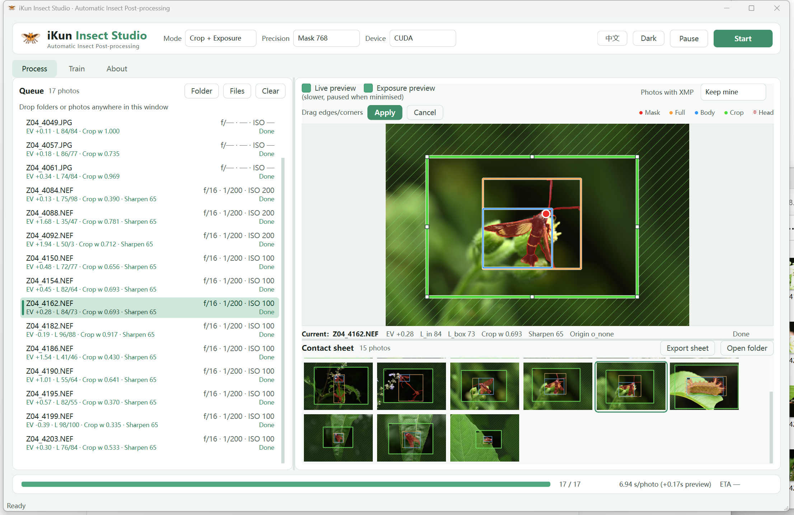

# iKun Insect Studio

**[Download](https://github.com/Inccc-zty/iKun-Insect-Studio/releases)** (GitHub first) · **[Netdisk mirror](https://pan.baidu.com/s/1dkWKy9bxWnTreHFD5cCBVA?pwd=8848)** (code 8848) ·
**[Manual](docs/manual.en.md)** · **[Technical report](docs/report.en.md)** · [中文](README.zh-CN.md)



**A tool that does the boring, repetitive part for you: find the insect, place the crop, set the exposure.**

A day out shooting means one record frame per individual. Only a handful are worth a full edit;
the other ninety are records — and in macro work the insect is always small in the frame
(hand-holding, not enough magnification, it will not let you closer). Uncroped, they are
"a bug somewhere in the middle". The hours go into the ninety, not the five.

This app does those two jobs and writes the result as a sidecar `.xmp` your editor already reads.

> **Crop and exposure can both be wrong. Nothing here is 100%.** The value is not accuracy, it is
> turning a hundred repetitive edits into a few minutes — you glance at the misses and fix them.
>
> Built against **Lightroom** and **Adobe Camera Raw (ACR)** as references. `.xmp` is Adobe's
> standard: Lightroom, Camera Raw, Bridge and Photoshop all read the same file.


---

## What it does

- **Crop** — a full-frame mask finds the insect, measures a body box and a whole box, and a
  105-term model predicts the crop. Hold-out IoU **0.865**. Usually usable as-is, sometimes off.
- **Exposure** — two p95 brightness numbers (inside the mask / background inside the box) into one
  straight line; hold-out MAE **0.29 EV** (constant baseline 0.41). An estimate: treat it as a start.
- **Sharpening** — by aperture, strictly increasing (20 → 65).

**Writes a sidecar `.xmp`**: the RAW stays as shot, and your white balance, colour and contrast carry over as they are — everything applies on import.

## Quick start (Windows)

1. Download the latest release and extract all parts into one folder.
2. Double-click `iKunInsectStudio.exe` (keep the whole folder together).
3. Drop a folder or a batch of RAWs, pick a mode, press **Start**.
   Then **import into your editor** — the `.xmp` is read on import. If the batch is already in
   Lightroom, click *Read Metadata from File* once there instead.

Models preload in the background for ~10–20 s; you can queue photos meanwhile.

## How it works, in one paragraph

Each photo is segmented **once** at 768² with BiRefNet. The mask gives two boxes (body via
morphological opening, whole via bounding box). A self-trained ResNet50 turns a 256² crop of the
body box into a 64×64 heat map, and soft-argmax turns it into a head point. Those numbers — 13 of
them — become 105 terms that predict the crop centre and width; two brightness percentiles become
the exposure; the aperture looks up the sharpening. Nothing else is estimated.

## Report

**[docs/report.md](docs/report.md)** — every scheme that was tried, why it was rejected,
and a full teardown of the one that survived. [English](docs/report.en.md).

## Numbers

| Module | Metric |
|---|---|
| Crop | hold-out IoU median **0.865**; 80-photo blind test **0.902** |
| Exposure | hold-out MAE **0.29 EV** (constant baseline 0.41) |
| Head point | median error **0.12 × core width** |
| White balance | a constant, MAE **163 K** — the best this approach reaches |

Metrics are hold-out: the model never sees the folders it is scored on.

## Repository layout

```
app/        engine (mask, crop, exposure, sharpening, XMP)
ui/         desktop UI (PySide6)
skill/      algorithm package: scripts + method notes + reference docs
docs/       bilingual manual + analysis reports
figures/    zh/ and en/ versions of every figure
```

Model weights (`head_kp_v2.pth`, 95 MB) and the Windows build live in **Releases**, not in git.

## Build from source

```bash
python -m venv .venv && .venv/Scripts/activate
pip install -r requirements.txt
python run.py                 # dev run
python build.py               # PyInstaller one-folder build
```

## License

MIT — see [LICENSE](LICENSE).

© 2026 Zheng Tianyu · Laboratory of Systematics and Evolutionary Entomology,
China Agricultural University.
