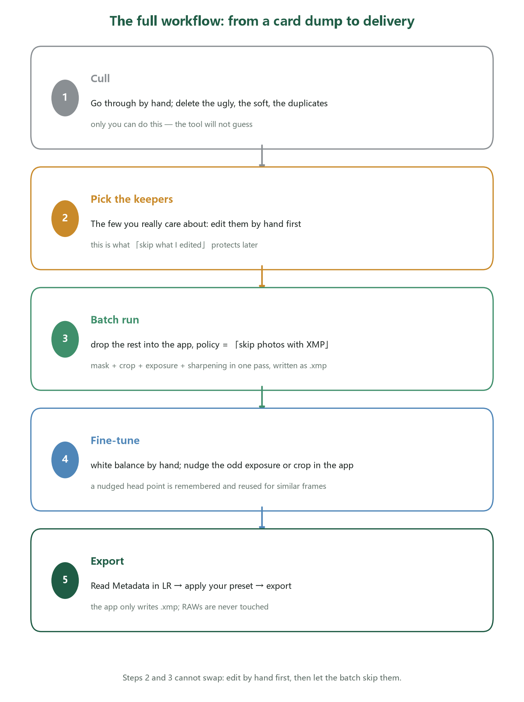

# iKun Insect Studio · Manual

> Written in the order you will actually use it: what it looks like running, how it plugs
> into Lightroom, the full workflow, then every control.
>
> 中文版：[manual.md](manual.md)

---

## 1 What it looks like

<video src="media/demo.mp4" controls width="100%"></video>

(If GitHub does not play it inline: [download demo.mp4](media/demo.mp4))

Drop a folder → mask, boxes and head point appear per photo → an `.xmp` lands beside every
RAW at the end. Nothing to click twice.

---

## 2 After a batch: the contact sheet

Three columns per row: **original / boxes and head point / result**. Scan 80 photos and the
ones that went wrong jump out.

---

## 3 How it plugs into Lightroom

**The only difference between the two cases is one action:**

| Your situation | What to do |
|---|---|
| Photos **already in** LR | after the run, select them in LR → right-click → **Read Metadata from File** |
| Photos **not imported yet** | run the app first, then import the RAWs — **the .xmp is read on import** |

The app **never touches the RAW**; it only writes the sidecar `.xmp`. Either order is safe.

---

## 4 The full workflow

| Step | Who | What |
|---|---|---|
| ① Cull | you | go through by hand, delete the soft, the duplicates, the ugly |
| ② Pick the keepers | you | edit the few you care about by hand, to taste |
| ③ Batch run | the app | drop the rest in, policy = **skip photos with XMP** |
| ④ Fine-tune | you + app | white balance by hand; nudge the odd exposure or crop |
| ⑤ Export | LR | Read Metadata → apply preset → export |

**Steps ② and ③ cannot swap.** Edit by hand first, then batch with 「skip photos with XMP」
so your hand-edited frames are never overwritten.

---

## 5 Every control

(to be filled with the Process / Train / About screenshots)
