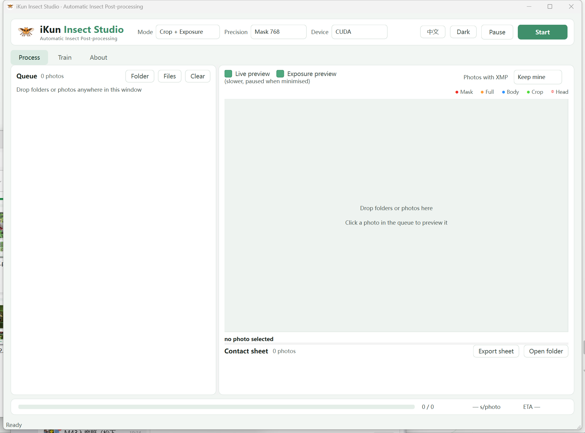
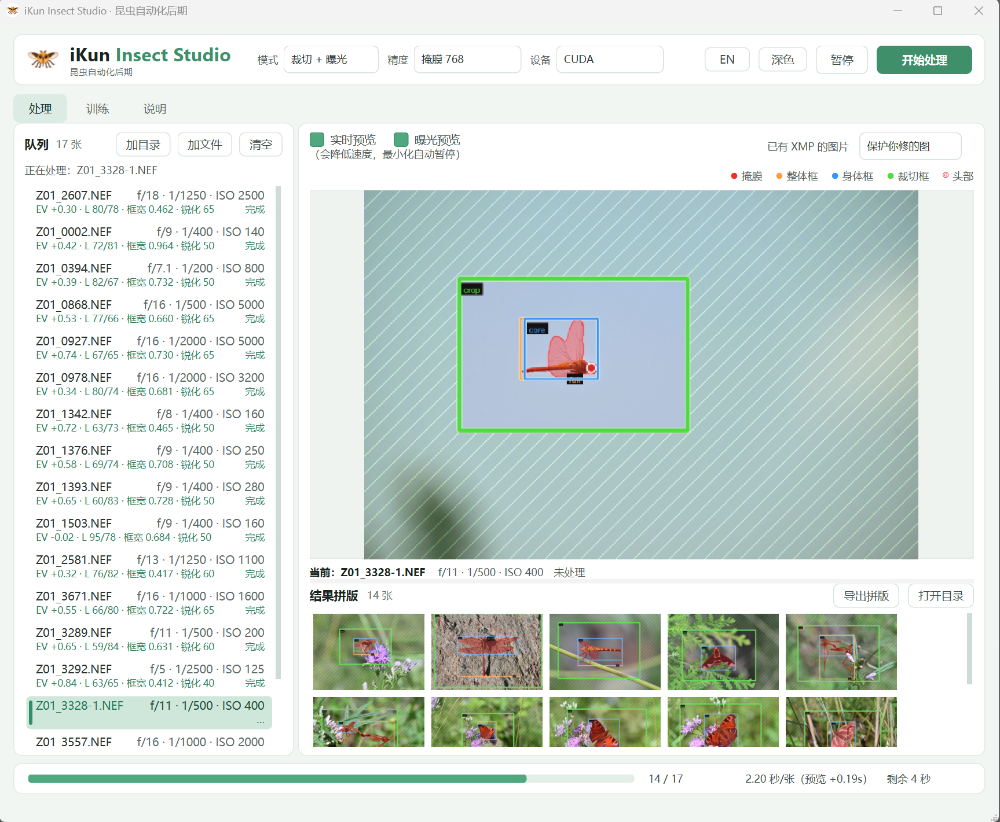
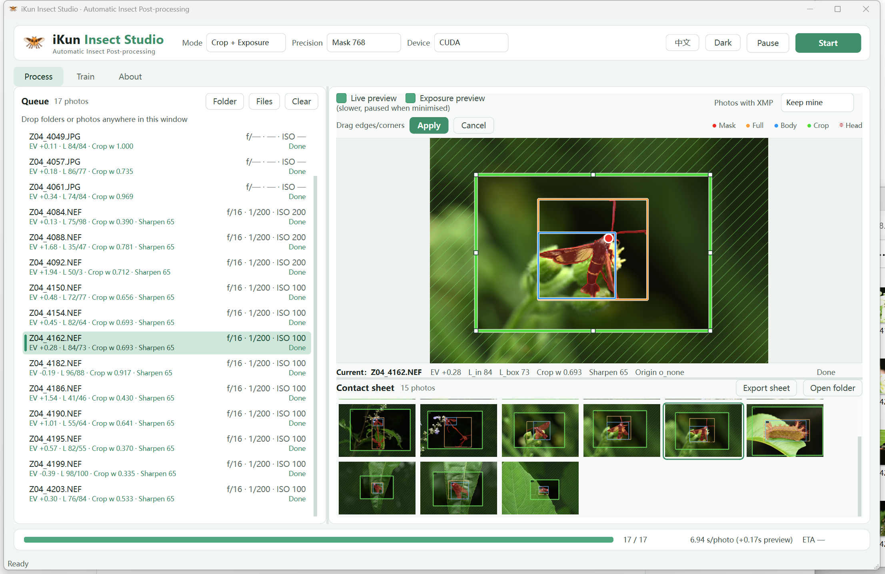
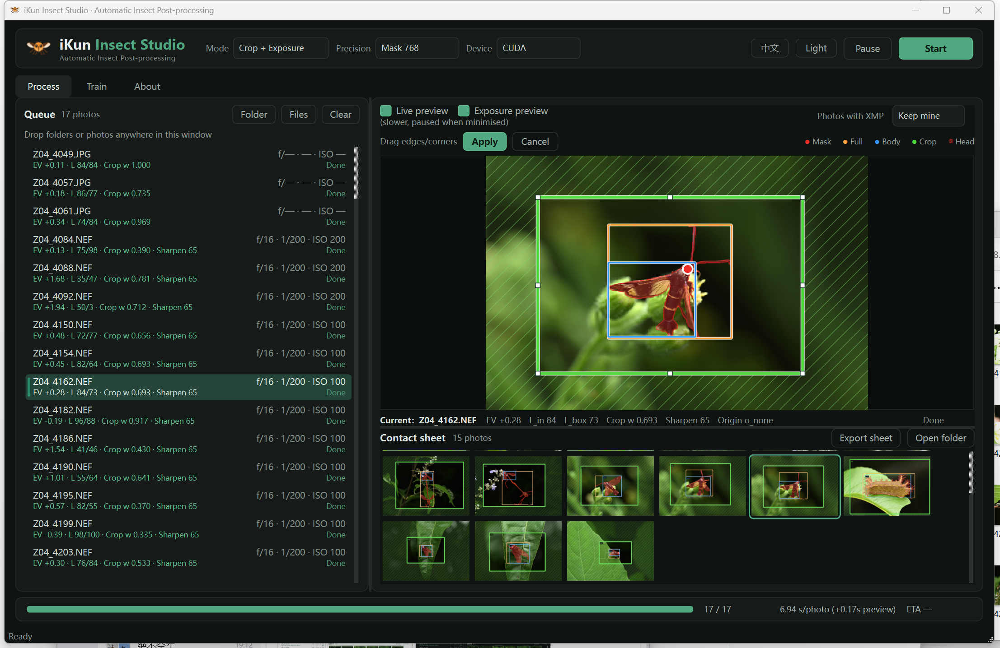
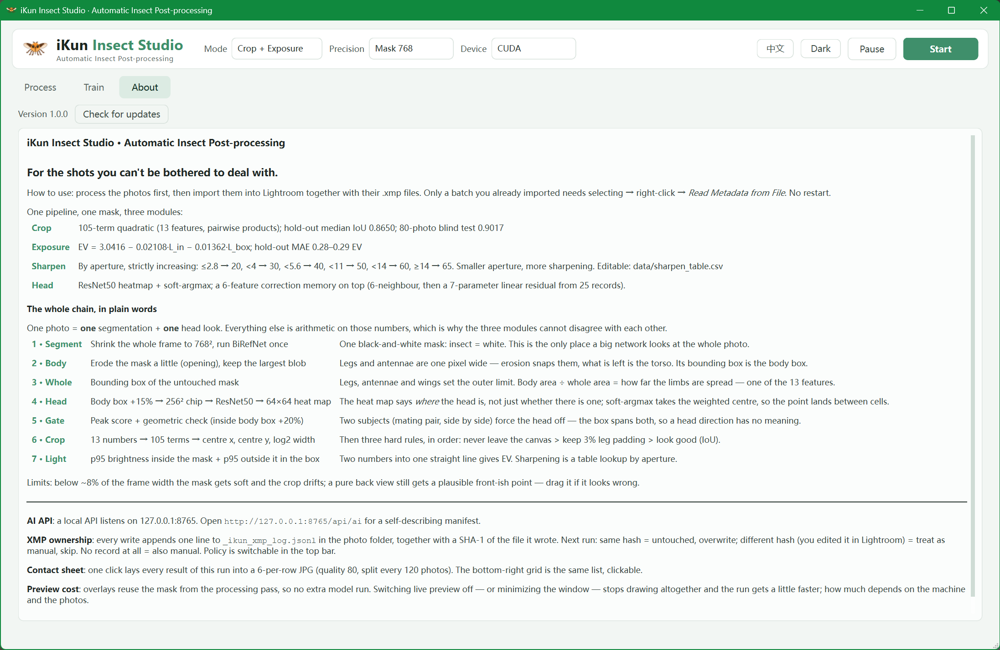

## 0 See it run

<video src="media/demo.mp4" controls width="100%"></video>

(If GitHub does not play it inline: [download the video](media/demo.mp4))

Drop a folder → mask, boxes and head point appear per photo → an `.xmp` lands beside every RAW.

**Download**: [Baidu Netdisk](https://pan.baidu.com/s/1dkWKy9bxWnTreHFD5cCBVA?pwd=8848) (code **8848**)

The file is `iKunInsectStudio.zip`, about 2.6 GB. Unzip it, keep the whole `iKunInsectStudio` folder
together, and run `iKunInsectStudio.exe` — do not copy the exe out on its own.

---

# iKun Insect Studio · Manual

> For people already shooting insects and editing in Lightroom, Camera Raw or an equivalent.
> 中文版：[manual.md](manual.md)

---

## 1 What it is

**A tool that does the boring, repetitive part for you: find the insect, place the crop, set the exposure.**

### Who it is for

Every field trip, every individual needs one record frame. Out of a hundred shots a day, a handful
are portfolio-grade and the rest are **records**. The records still need cropping — in macro work
the insect is always small in the frame: hand-holding shakes, the magnification is rarely enough,
and the insect will not let you get closer. Uncroped, the photo is "a bug somewhere in the middle".

So what actually eats your evening is not the five good frames — it is the other ninety-five:
the same crop, the same exposure nudge, over and over.

**The app does exactly those two things:**

- **Crop** — usually usable as-is, sometimes off
- **Exposure** — an estimate, often off

Either can be wrong; nothing here is 100%. The value is not accuracy, it is **turning a hundred
repetitive edits into a few minutes** — you glance at the misses and fix them, which is far faster
than cropping from scratch.

The result is a sidecar `.xmp` that post-processing software reads directly.

> The app was built against **Lightroom** and **Adobe Camera Raw (ACR)** as references.
> `.xmp` is Adobe's open sidecar standard: Lightroom, Camera Raw, Bridge and Photoshop all read it.
> Whenever this manual says "post-processing software", it means that family.

Three columns per row: original / boxes and head point / result.

---

## 2 The standard workflow

| Step | Where | What | Output |
|---|---|---|---|
| ① Cull | any culling tool | go through by batch; delete soft, shaken, duplicated, blocked | a clean candidate set |
| ② Pick the keepers | Lightroom | only 5–10%, finished by hand | a few publishable frames |
| ③ Batch run · **the app** | iKun Insect Studio | drop the rest in, policy = protect what I edited | one `.xmp` per photo |
| ④ Global fine-tuning | post-processing app | white balance, overall exposure, colour, local adjustments — in bulk | one consistent look |
| ⑤ Export | post-processing app | preset → export (size, output sharpening, watermark) | deliverables |

**② and ③ cannot swap**: finish the hand edits first, then let the batch skip them.

> **Back up the `.xmp` of the frames you finished by hand.** The batch honours your policy, but the
> safe order is: edit → *Save metadata to file* in your editor (or copy the `.xmp` elsewhere) → run
> the batch. A wrong policy then costs nothing.
>
> A new `.xmp` written by the app does not change what you already see — the editor has to read it
> again. Overwriting is therefore irreversible; the backup is the only insurance.

> **What to cull with**: Lightroom works, but a dedicated culler is faster — Nikon NX Studio, for
> instance, is much quicker for browsing and rating. Other makers have their own; use whatever
> feels right.

### About step ④

**The real fine-tuning happens in post-processing software** (Lightroom / Camera Raw) — white balance, overall exposure, tone curve, local
masks. That is where a batch becomes one look, and it is a judgement call, not a measurement.
The app only puts the crop and the exposure on the sliders.

> White balance is deliberately not written: whether a scene should be cooler or warmer is an
> expressive choice, not something you measure off the frame.

---

## 3 After installing

1. Unzip to a **fixed folder** (not the Desktop, and do not rename it later), e.g. `D:/iKunInsectStudio`
2. Double-click `iKunInsectStudio.exe`
3. First launch loads the models in 10–20 s; **the window appears first and the models load in the
   background**, so you can queue photos immediately
4. To reset: close the app, double-click `重置到初始状态.bat` in the same folder
   (**models you trained or imported are kept**; only settings and caches are cleared — use `--reset-all` to wipe those too)

> An NVIDIA GPU (4 GB+) is recommended. CPU works too, at 5–10 s per photo.

---

> **GPU**: NVIDIA, 4 GB of VRAM and up. See the table below — running out of VRAM does not crash
> anything, the app falls back to 384 px and keeps going, with slightly softer masks for small insects.

### GPU requirements (measured)

| Tier | Hardware | Reality |
|---|---|---|
| **Recommended** | NVIDIA with 6 GB+ (RTX 2060 / 3060 and up) | 768 px runs comfortably, 1–2 s per photo |
| **Usable** | NVIDIA 4 GB (GTX 1650, RTX 3050 laptop) | 512 is safe; 768 depends on desktop usage — the app drops to 512 or 384 when it gets tight |
| **Marginal** | NVIDIA 2 GB | Switch the mask to **384** manually and it runs steadily; masks are softer and small insects (under 10% of frame width) crop slightly off |
| **No GPU / AMD / Intel** | Falls back to CPU | **145 s per photo** (measured) — about 4 hours for 100 frames. It works, but not for batches |

Requires a CUDA 11.8 capable card (Maxwell sm_50 and newer, i.e. GTX 10 series onward); older cards
fall back to CPU.

Measured on one frame: 768 → 0.77 s, 512 → 0.50 s, 384 → 0.39 s; mask agreement with 768 is 0.962 and 0.928.

When VRAM runs out: the app calls `torch.cuda.empty_cache()`, re-runs at half resolution (768→384) and
flags the result as `degraded`, including a note in `params.csv`. It never returns a silently wrong box.

---

## 4 How to run your first batch

1. Drop **a folder**, or **a batch of photos**, onto the window
2. Mode: `Crop + Exposure`
3. 「Photos with XMP」 → **protect what I edited**
4. Press **Start**
5. **Import the batch into your post-processing software** — the `.xmp` is read on import and the crop and exposure land on the sliders

> Only if these photos are **already in the software** do you need one extra click: select all → right-click →
> **Read Metadata from File**.

---

## 5 The three numbers it writes

| Written to `.xmp` | What |
|---|---|
| **Crop box** | position + size |
| **Exposure** | one EV value |
| **Sharpening** | amount for that aperture |

They go into the sidecar `.xmp` next to the photo and apply on import; the RAW stays as shot and your
white balance, colour and contrast carry over as they are.

Where the three numbers come from:

- **Crop**: BiRefNet mask → body box + whole box + head point, 13 numbers expanded to 105 terms
- **Exposure**: p95 luma inside the mask + p95 luma of the box background, regressed to your EV
- **Sharpening**: aperture only; the smaller the aperture, the more sharpening

---

## 6 How it plugs into your post-processing software

Two cases, one action differs:

| Your situation | What to do |
|---|---|
| **New import** | just import — **the `.xmp` is read on import**, nothing else to click |
| The batch is **already in** the software | after the run: select all → right-click → **Read Metadata from File** |

**The RAW is never modified**, so either order is safe.

---

## 7 Two optional extras (not part of the mainline)

Neither is required; skipping both still gives you a complete batch.

### 7.1 Nudging the head point inside the app

When: one frame got the head wrong and the crop followed it.

How: open the photo → drag the head point → **Done**. The correction is remembered and applied to
geometrically similar frames (nearest-neighbour from 3 records, a 7-parameter linear residual from 25).

- It only moves the **crop box**; nothing is written into Lightroom
- **Every nudge makes the model fit your judgement better** — the corrections accumulate as
  training samples and can be exported at any time (see 7.2)

> **Why does it say "from 3 records" and also "25 records to refit"?**
> Two different mechanisms:
> - **From 3**: no training at all — a lookup. Find the 3 nearest corrections by geometry, weight
>   them by distance, nudge the box. No model file, effective immediately.
> - **From 25**: enough samples to fit a 7-parameter linear residual model — that is what "refit" means.
>
> 3 records copies past experience; 25 records summarises it. Below 25, copying is enough.
- Not a per-batch step: fix it when you see it

### 7.2 Training your own crop model

When: your subjects look very different from the built-in set (all super-macro, all groups).

How: Train tab → add folders → Start. It uses **your own edited photos with XMP sidecars**,
reads how you actually cropped, and fits a new set of coefficients. The result sits alongside the
built-in model and you can switch back at any time.

- Needs **at least a few dozen** edited photos; more is better
- The output is a coefficient file only, no images, easy to copy elsewhere
- Again: nothing changes inside Lightroom

> Both are in the app, but **neither is a step in the workflow**. In normal use you finish ③ and go
> straight to Lightroom.

---

## 8 What the screens look like

**On launch**: the queue is on the left — drop folders or photos anywhere in the window. Preview and
contact sheet on the right.

**Running**: mask (red), whole box (yellow), body box (blue), crop (green), head point (circle).

**When it finishes**: every row shows EV, crop width and sharpening; the right side lets you nudge a
frame, with the contact sheet below.

Dark mode:

**Train tab**: add folders (the count is what you picked), pause, and read the log.

**About tab**: version, update check, and what each module actually is.

---

## 9 When something goes wrong

The rule is simple: **it never quietly returns a wrong result.** Every failure leaves a trace — either a
note in `params.csv`, or the frame is marked failed and the batch moves on.

| Symptom | Cause | What the app does |
|---|---|---|
| Mask looks soft, small insects crop slightly off | Not enough VRAM | Clears the cache, re-runs 768 → 384, flags `degraded` with a note; never crashes |
| One to two minutes per photo | No CUDA (AMD / Intel / iGPU / too old a card) | Falls back to CPU: 145 s per photo measured, ~4 h for 100 frames |
| Crashes on launch | Only the exe was copied, `_internal` was left behind | Fails immediately. **Keep the whole folder together** |
| One frame keeps failing | File locked / folder read-only / broken RAW | Marks that frame `FAILED`, draws a red frame in the sheet, continues |
| Nothing changes in the editor | The batch ran before the import | Select all → right click → Read metadata from file |

### Where the settings live

`data/config.json`; the switches in the UI write to it. Deleting the file restores the defaults
(`重置到初始状态.bat` does this too, and **keeps the models you trained**).

| Key | Values | Meaning |
|---|---|---|
| `mode` | `both` / `crop` / `exposure` | Everything / crop only / exposure only |
| `seg_size` | `768` / `512` / `384` | Segmentation resolution; lower is faster and softer on small insects. 384 is the low-VRAM fallback |
| `device` | `cuda` / `cpu` | Use cuda when an NVIDIA card is present |
| `preview_enabled` | `true` / `false` | Live preview; off is noticeably faster |
| `preview_exposure` | `true` / `false` | Exposure overlay, follows the live-preview switch |
| `coef` / `ev_coef` | model path, empty = built-in | Where trained models go |
| `xmp_policy` | `protect` / `overwrite` | Existing XMPs: fill only untouched ones / rewrite all |
| `sharpen_enable` | `true` / `false` | Write the aperture-based sharpening amount |

---

## 10 FAQ

**Q: Nothing changed in my software.**
A: Check whether the run happened **before** import. A run before import is picked up automatically;
a run after import needs one click on Read Metadata from File.

**Q: Will it overwrite my edits?**
A: With 「protect what I edited」 it only fills the ones you have not touched. 「Overwrite」 changes all.

**Q: Why is white balance always untouched?**
A: The app does not guess colour temperature. Your setting is a fixed habit, not a function of the
illuminant, so guessing would be wrong.

**Q: How long does a batch take?**
A: 1–3 s per photo on a GPU; faster with live preview off.

---

## 11 Known limits

1. **No rotated crops.** About 8% of your finished crops are rotated; the app only produces
   axis-aligned boxes, so those will not match. May be added later.
2. **No white balance.** Not for lack of trying: nothing we tried predicts your setting well —
   inside/outside the mask, specular highlights, multi-feature models — a constant beats them all.
3. **Exposure is an estimate.** Large moves (±1.5 EV and beyond) drift; use it as a starting point.
4. **Small insects drift.** When the insect is under 8% of the frame width the mask blurs and the
   box can be off — check those frames.

---

## 12 Why it is 4.4 GB

Unzip it and you get a 4.4 GB folder with **not a single photo** in it. The breakdown:

| Part | Size | What it is |
|---|---|---|
| PyTorch + CUDA runtime | **~3.9 GB** | the libraries that let the models run on the GPU |
| Model weights | ~420 MB | segmentation model + head keypoint model |
| Qt, OpenCV, image decoding | ~200 MB | the window, RAW reading, preview rendering |
| Scripts and config | a few MB | the actual logic |

### What those 3.9 GB are

| File | Size | Job | Removable? |
|---|---|---|---|
| `torch_cuda.dll` | 1.33 GB | GPU kernels | no, core |
| `cudnn_engines_precompiled` | 563 MB | convolution kernels | no — removing it costs 10× speed or breaks outright |
| `cublasLt` | 519 MB | matrix multiply | no |
| `cusolver / cufft / cusparse` | 817 MB | solvers, FFT, sparse | **no** — `torch_cuda.dll` imports them statically; remove them and `import torch` fails (tested) |
| `torch_cpu.dll` | 241 MB | CPU fallback kernels | no |

### Why CUDA at all

Without it everything runs on CPU: **0.3 s → 5–10 s per photo**, i.e. an extra hour on a 500-frame batch.
Not a good trade, so the CUDA build is the default.

### Could it be smaller

Yes, by changing the inference engine:

| Option | Size | Cost |
|---|---|---|
| Current (PyTorch + CUDA) | 4.4 GB | — |
| ONNX Runtime (CUDA) | ~1.8 GB | export both models, verify accuracy frame by frame |
| ONNX Runtime (CPU) | ~0.8 GB | tiny, but 5 s per photo and up |

Not done yet: **these coefficients were calibrated on PyTorch**, so switching engines means re-validating
accuracy, not just swapping a library.
