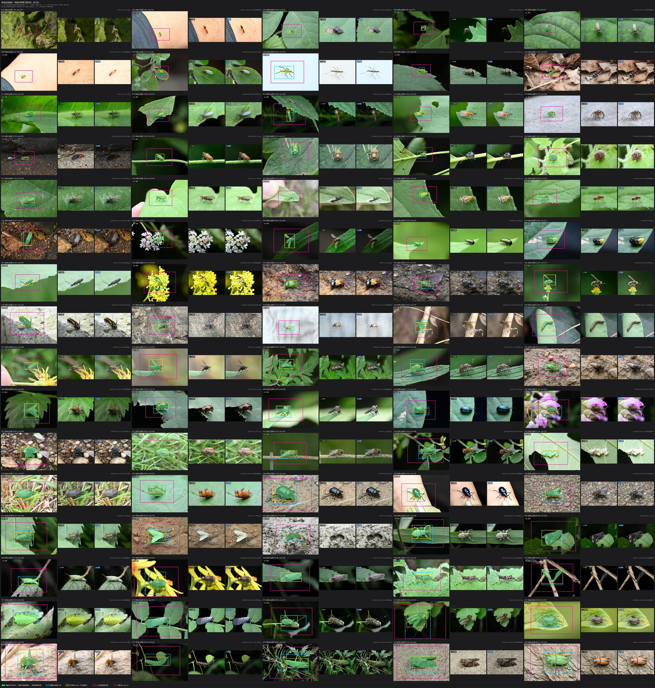
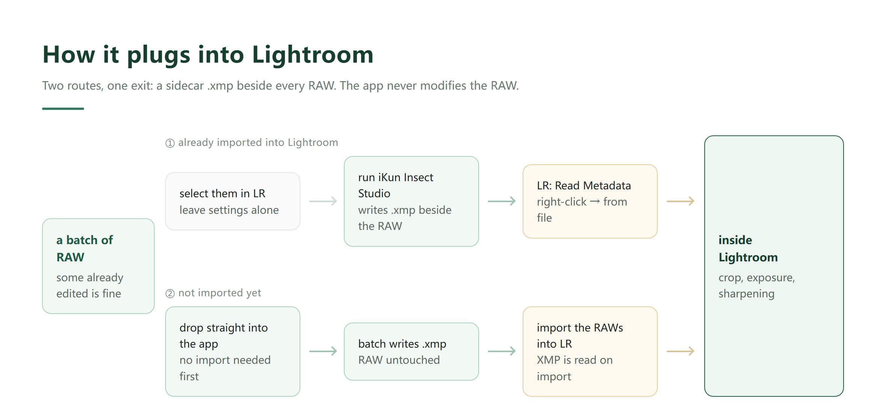

# iKun Insect Studio · Manual

> For people already shooting insects and editing in Lightroom (or an equivalent).
> It does three repetitive jobs for you — **find the insect → place the crop → set the exposure** —
> and writes the result as an `.xmp` that Lightroom reads.
>
> 中文版：[manual.md](manual.md)

---

## 0 In one line

**It is not an editor. It is a batch tool that turns repetitive decisions into parameters.**

After a run, every RAW has a sidecar `.xmp`; Lightroom reads it and the crop, exposure and
sharpening are already on the sliders. **White balance is left alone** — that depends on what
you want to say, not on a measurement.

---

## 1 After installing

1. Unzip to a **fixed folder** (not the Desktop, and do not rename it later), e.g. `D:/iKunInsectStudio`
2. Double-click `iKunInsectStudio.exe`
3. First launch loads the models in 10–20 s; **the window appears first and the models load in
   the background**, so you can drop photos in immediately
4. To reset: close the app, double-click `重置到初始状态.bat` in the same folder

> An NVIDIA GPU (4 GB+) is recommended. It also runs on CPU, at 5–10 s per photo.

---

## 2 First batch in five minutes

1. Drop **one folder** onto the window
2. Mode: `Crop + Exposure`
3. 「Photos with XMP」 → **protect what I edited**
4. Press **Start**
5. In Lightroom: select the batch → right-click → **Read Metadata from File**

Three columns per row: original / boxes and head point / result.

---

## 3 What it changes, and what it does not

| | |
|---|---|
| **Changes** | crop box (position + size), exposure EV, sharpening amount |
| **Leaves alone** | white balance, colour, contrast, local adjustments |
| **Never touches** | the RAW. Only a sidecar `.xmp` |

Where the three numbers come from:

- **Crop**: BiRefNet mask → body box + whole box + head point, 13 numbers expanded to 105 terms
- **Exposure**: p95 luma inside the mask + p95 luma of the box background, regressed to your EV
- **Sharpening**: aperture only; the smaller the aperture, the more sharpening

---

## 4 How it plugs into Lightroom

Two cases, one action differs:

| Your situation | What to do |
|---|---|
| Photos **already in** LR | after the run: select them in LR → right-click → **Read Metadata from File** |
| Photos **not imported yet** | run the app first, then import into LR — **the XMP is read on import** |

**The RAW is never modified**, so either order is safe.

---

## 5 The standard workflow

| Step | Where | What | Output |
|---|---|---|---|
| ① Cull | Explorer / LR | go through by batch, delete soft, shaken, duplicated, blocked | a clean candidate set |
| ② Pick the keepers | Lightroom | only 5–10%, finished by hand | a few publishable frames |
| ③ Batch run · **the app** | iKun Insect Studio | drop the rest in, policy = protect what I edited | one `.xmp` per photo |
| ④ Global fine-tuning · **Lightroom** | Lightroom | white balance, overall exposure, colour, local adjustments — in bulk | one consistent look |
| ⑤ Export · **Lightroom** | Lightroom | preset → export (size, output sharpening, watermark) | deliverables |

**② and ③ cannot swap**: finish the hand edits first, then let the batch skip them.

### About step ④

**The real fine-tuning happens in Lightroom** — white balance, overall exposure, tone curve,
local masks. That is where a batch becomes one look, and it is a judgement call, not a measurement.
The app only puts the crop and the exposure on the sliders.

> White balance is deliberately not written: whether a scene should be cooler or warmer is an
> expressive choice, not something you can measure off the frame.

---

## 6 Two optional extras (not part of the mainline)

Neither is required; skipping both still gives you a complete batch.

### 6.1 Nudging the head point inside the app

When: one frame got the head wrong and the crop followed it.

How: open the photo → drag the head point → **Done**. The correction is remembered and applied to
geometrically similar frames (nearest-neighbour from 3 records, a 7-parameter linear residual from 25).

- It only moves the **crop box**; nothing is written into Lightroom
- A rescue for the odd frame, not a per-batch step
- You can export the accumulated corrections as training samples (see 6.2)

### 6.2 Training your own crop model

When: your subjects look very different from the built-in set (all super-macro, all groups).

How: Train tab → add folders → Start. It uses **your own edited photos with XMP sidecars**,
reads how you actually cropped, and fits a new set of coefficients. The result sits alongside the
built-in model and you can switch back at any time.

- Needs **at least a few dozen** edited photos; more is better
- The output is a coefficient file only, no images, easy to copy elsewhere
- Again: nothing changes inside Lightroom

> Both are in the app, but **neither is a step in the workflow**. In normal use you finish ③ and go
> straight to Lightroom.

---

## 7 The interface

(to be filled with the Process / Train / About screenshots)

---

## 8 FAQ

**Q: Nothing changed in Lightroom.**
A: The photos were edited after import — you must click Read Metadata from File once. Fresh imports
do not need it.

**Q: Will it overwrite my edits?**
A: With 「protect what I edited」 it only fills the ones you have not touched. 「Overwrite」 changes all.

**Q: Why is white balance always untouched?**
A: The app does not guess colour temperature. Your setting is a fixed habit, not a function of the
illuminant, so guessing would be wrong.

**Q: How long does a batch take?**
A: 1–3 s per photo on a GPU; faster with live preview off.

---

## 9 Known limits

1. **Close-ups like the Qinghai set** (insect fills the frame, edge-hugging, multi-subject): IoU 0.70
   against 0.76–0.88 elsewhere
2. **Rotated crops** (~8%): the app only produces axis-aligned boxes
3. **No white balance, no local adjustments** — always yours to do
4. When the insect is under 8% of the frame width the mask blurs and the box drifts — check the image
