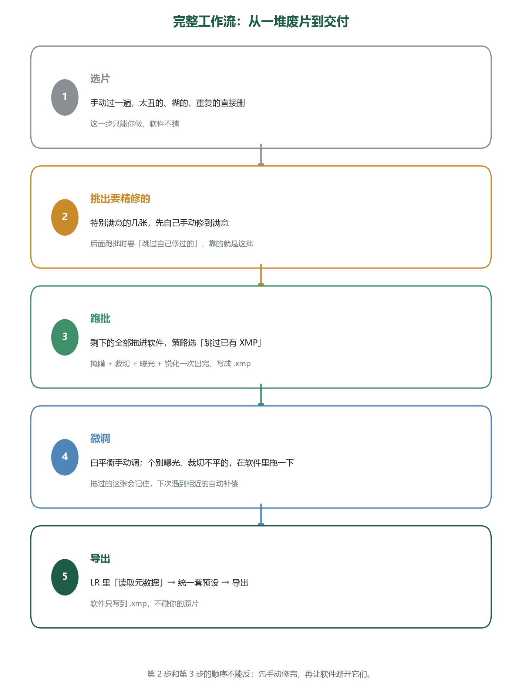
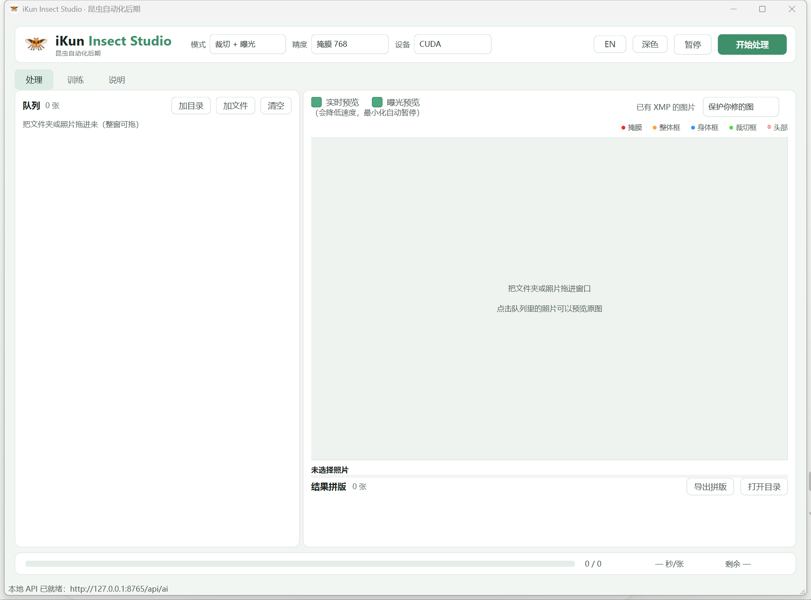
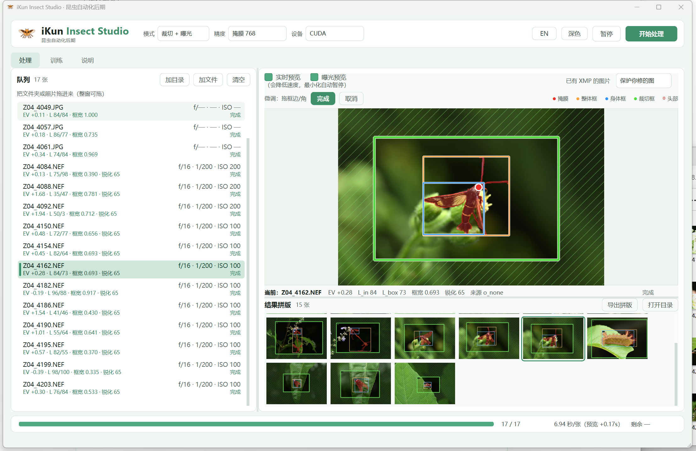
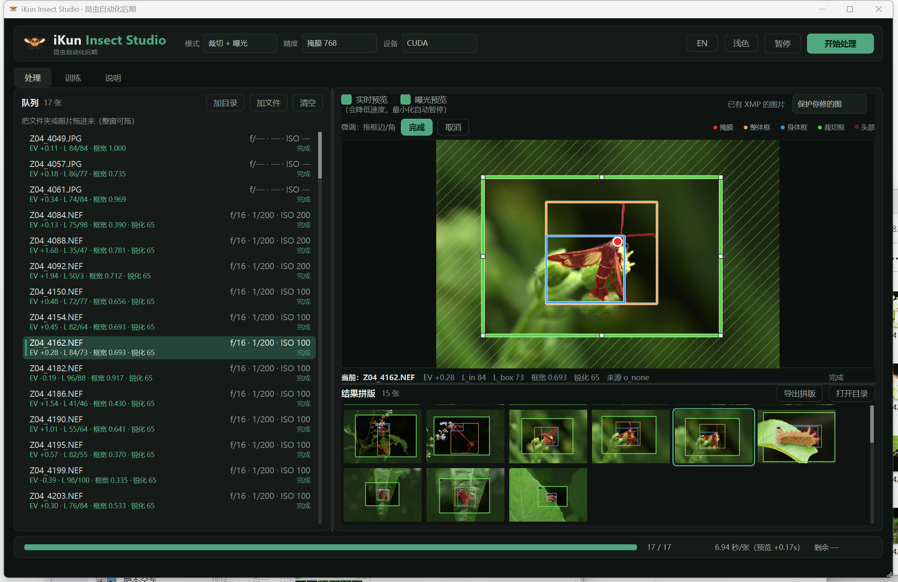
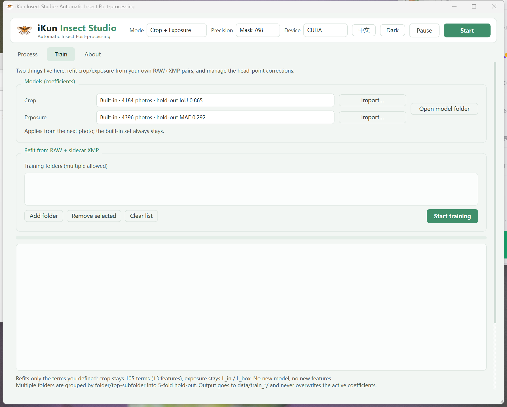
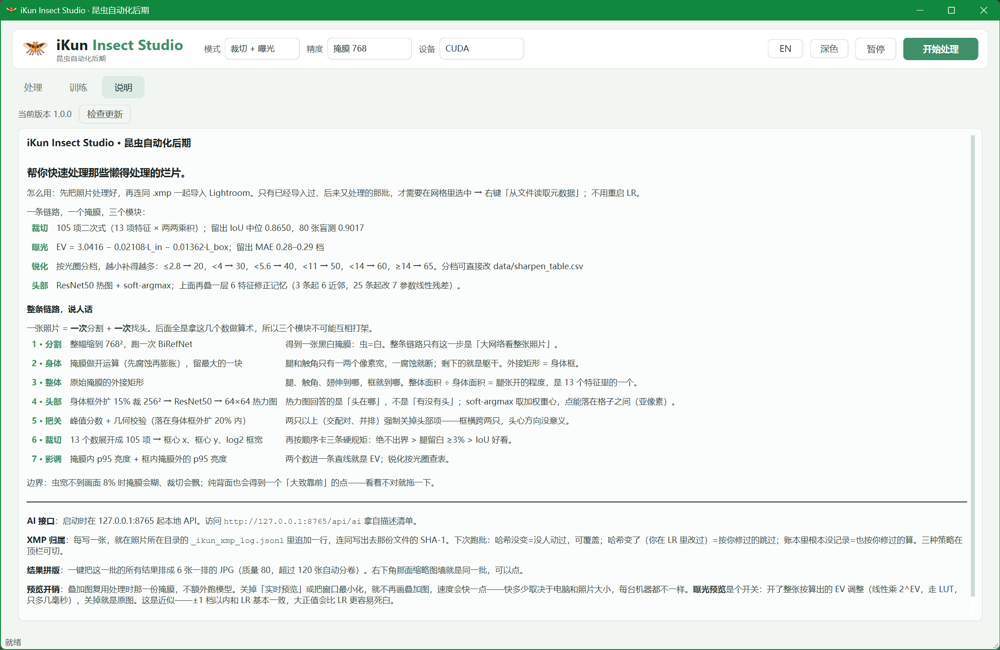
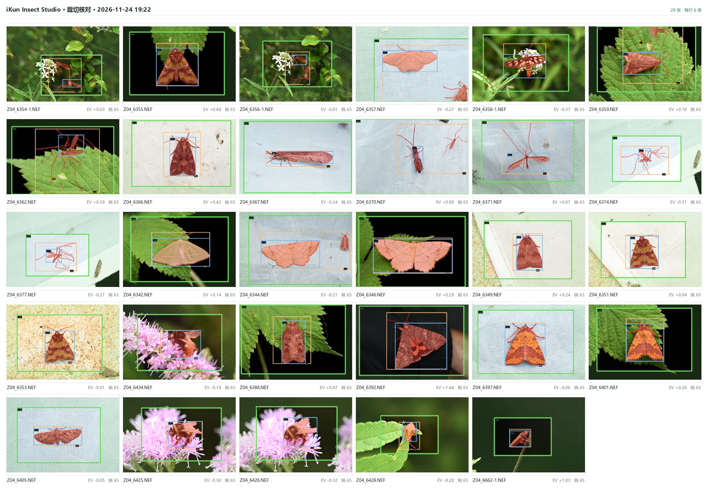

# iKun Insect Studio · 使用说明

> 给已经在拍虫子、并且用图像后期软件（Lightroom / Camera Raw）修图的人。
> English: [manual.en.md](manual.en.md)

---

## 0 先看它跑起来

<video src="media/demo.mp4" controls width="100%"></video>

（GitHub 不内嵌播放时，点这里下载视频：[demo.mp4](media/demo.mp4)）

拖入文件夹 → 逐张出掩膜、框、头点 → 结束时在每张 RAW 旁边写一个 `.xmp`。全程不用点第二次。

**下载**：优先用 **[GitHub Releases](https://github.com/Inccc-zty/iKun-Insect-Studio/releases)**（两个分卷 + `join-parts.bat`，约 2.6 GB）。
GitHub 下不动或中途断流，再用 [百度网盘](https://pan.baidu.com/s/1l1-JLttPB9EuO1Mz6AbbIw?pwd=8848)（提取码 **8848**）的整包。

两个分卷放同一个文件夹，双击 `join-parts.bat` 合成一个 zip，解压得到 `iKunInsectStudio` 文件夹，
双击里面的 `iKunInsectStudio.exe` 即可 —— **整个文件夹要一起留着**，不能只拷 exe。

---

## 1 它是干什么的

**它是一个替你做无聊重复动作的工具：找虫、定框、给曝光。**

### 适用场景

每次外拍，每个个体你都得留一张记录。一天拍一百张，可能只有几张是大片，其余都是**记录级**。
记录级也得裁——微距这个题材，虫子天生就在画面里偏小：手持会晃、放大倍率往往不够、虫子也不肯让你靠太近。
不裁，虫子缩在照片中间一小点。

于是每批真正吃掉时间的，不是那几张大片，是剩下几十上百张的重复裁切、重复调曝光。

**这个软件只干这两件事**：

- **裁切**——大部分能直接用，少数会偏
- **曝光**——估计值，常常偏

两个都可能出错，没有一个是 100% 准的。它的价值不在"准"，在**把几十上百张的重复劳动压成几分钟**——
剩下不对的，你扫一眼改掉，比从零开始裁快得多。

结果写成同名 `.xmp`，图像后期软件直接认。

> 本软件是拿 **Lightroom** 和 **Adobe Camera Raw（ACR）** 做参考开发的。
> `.xmp` 是 Adobe 的通用标准，Lightroom、Camera Raw、Bridge、Photoshop 都读同一份；
> 下面说到「图像后期软件」，指的就是这一类（例子里写的是 LR 的菜单）。

每行三张：原图 / 框与头点 / 成片。80 张扫一遍，哪张没框对直接能看出来。

---

## 2 标准工作流

| 步 | 在哪做 | 做什么 | 产出 |
|---|---|---|---|
| ① 选片 | 选片工具 | 按批次过一遍，糊的、抖的、重复的、遮挡的直接删 | 干净的候选集 |
| ② 挑出要精修的 | Lightroom | 只挑 5–10%，完整后期手工做完 | 几张能发表的成片 |
| ③ 跑批 · **软件** | iKun Insect Studio | 其余全部拖进去，策略选「保护你修的图」 | 每张一个 `.xmp` |
| ④ 统一微调 | 图像后期软件 | 白平衡、整体曝光、色彩、局部调整，成批做 | 一致的色调 |
| ⑤ 导出 | 图像后期软件 | 套预设 → 导出（尺寸、输出锐化、水印） | 交付文件 |

**②和③不能换序**：先把要精修的做完，再让跑批跳过它们，否则刚调好的那几张会被覆盖。

> **修完那几张，先把它们的 `.xmp` 备份出来。** 软件跑批时会按策略决定动不动它们，
> 但最稳的做法是：精修完 → 在图像后期软件里「存储元数据到文件」（或把同名 `.xmp` 复制一份到别处）→
> 再跑批。这样即使策略选错，裁切和曝光也还在。
>
> 反过来也成立：**软件写出新的 `.xmp` 不会自动改变你已经调好的画**，
> 后期软件要重新「读取元数据」才会应用。所以覆盖是不可逆的，备份是唯一保险。

> **选片用什么**：LR 也行，但专门的选片工具更快。比如尼康工坊（NX Studio），翻片和打星比 LR 快不少；
> 别家相机厂也有各自的工具，用顺手的就行。

### 关于第 ④ 步

**真正的微调在图像后期软件里**（Lightroom / Camera Raw）——白平衡、整体曝光、色调曲线、局部蒙版，这些是成批做的，
也是决定「这一批看起来是不是一套」的地方。软件只负责把框和曝光送到滑杆上，剩下的判断归你。

> 软件**不写白平衡**是刻意的：同一个场景你想要冷一点还是暖一点，取决于表达，不取决于测量。

---

## 3 装好之后

1. 把压缩包解压到**一个固定目录**（不要放桌面，也别中途改名），例如 `D:/iKunInsectStudio`
2. 双击 `iKunInsectStudio.exe`
3. 首次启动加载模型约 10–20 秒，**窗口先出来、模型在后台加载**，可以直接拖照片排队
4. 想恢复出厂：关掉软件，双击同目录的 `重置到初始状态.bat`
   （**你训练/导入的模型会保留**，只清设置和缓存；要连模型一起清就用 `--reset-all`）

> **显卡**：NVIDIA，4 GB 显存起。具体分档见下表——显存不够不会崩，软件会降到 384 继续跑，只是小虫那档会偏。

### 显卡要求与精度分档（实测）

**按「可用显存」选档，不是按总显存。** 桌面本身要吃掉一部分（Edge、资源管理器、聊天软件，
常态 1.2–2 GB），能用的只有剩下的。

| 精度 | 峰值显存 | 需要「可用」显存 | 单张推理 | 适合的卡 |
|---|---:|---:|---:|---|
| **384** | ≈0.9 GB | ≥1.2 GB | 0.39 s | 2 GB 卡；或 4 GB 卡同时开着浏览器 |
| **512** | ≈1.5 GB | ≥1.8 GB | 0.50 s | 4 GB 卡（GTX 1650 / RTX 3050 笔记本）→ **首选** |
| **768** | ≈2.3 GB | ≥2.6 GB | 0.77 s | 6 GB 及以上 |
| **1024** | ≈3.5 GB | ≥4.0 GB | — | 12 GB 以上；4 GB 卡会直接 OOM |

> **档位选高了不会报错，只会变得极慢。**
>
> 显存装不下时，Windows 不会停下来提示，而是把显存放不下的部分挪到内存里、来回搬（WDDM 分页）。
> 任务管理器里 GPU 占用看着只有 30–50%，但每张从 0.8 秒掉到 3 秒以上，风扇一直转，整批下来差十几倍。
> 实测：同一张图、同一份代码，768 档在显存空闲时 **0.77 s**，桌面占了 2 GB 显存之后 **3.19 s**。
>
> **怎么判断自己正踩在这个坑里**：任务管理器 → 性能 → GPU → 「专用 GPU 内存」已经接近满；
> 或者 `data/perf.log` 里每张的总耗时忽高忽低。往下调一档，速度立刻回来。
>
> 4 GB 卡开着一堆浏览器标签还选 768，就是最典型的触发方式。

其余硬件口径：

| 档位 | 硬件 | 结果 |
|---|---|---|
| **没显卡 / AMD / Intel** | 自动切 CPU | **145 秒/张**（实测），100 张约 4 小时。能出结果，不适合批量 |
| CUDA 版本 | 需 CUDA 11.8 支持（Maxwell sm_50 起，即 GTX 10 系及以后） | 更老的卡退回 CPU |

掩膜质量：512 与 768 的一致度 **0.962**，384 与 768 是 **0.928**。差的是小虫（占画幅 <10%）的边缘，
大体型昆虫三档几乎没区别。

显存不够时的自动行为：先 `torch.cuda.empty_cache()`，再按 768→512→384 降档重跑，结果里标 `degraded`，
`params.csv` 的 note 也会写出来。**不会静默给个错框**，但降档重跑本身也费时间——不如一开始就选对。

---

## 4 如何跑通第一批

1. 把一个**文件夹**，或者**一批图片**，拖进窗口
2. 右侧模式选 `裁切 + 曝光`
3. 「已有 XMP 的图片」选 **保护你修的图**
4. 点 **开始**
5. 跑完**直接把这批照片导入图像后期软件**，导入时它自己会读 `.xmp`，框和曝光就带进去了

> 如果这批照片**已经在软件里**（不是新导入的），才需要额外做一次：全选 → 右键 → **从文件读取元数据**。

---

## 5 它写进去的三个数

| 写进 `.xmp` 的 | 内容 |
|---|---|
| **裁切框** | 位置 + 边长 |
| **曝光** | 一个 EV 值 |
| **锐化** | 按光圈对应的量 |

这三样写在照片旁边的同名 `.xmp` 里，导入时一起生效；原片保持原样，你的白平衡、色彩、对比沿用现有设定。
三个数字从哪来：

- **裁切**：BiRefNet 掩膜 → 身体框 + 整体框 + 头点，13 个数展开成 105 项，预测框心与框宽
- **曝光**：掩膜内亮度 p95 + 框内背景亮度 p95，两个数线性回归到你标定的 EV
- **锐化**：只看光圈，越小补得越多

---

## 6 它和图像后期软件怎么配合

两种情况，只有一个动作不同：

| 你的情况 | 要做什么 |
|---|---|
| **新导入**这批照片 | 直接导入，**导入时自动读 `.xmp`**，不用再点 |
| 这批照片**早就在**软件里 | 跑完软件后：全选 → 右键 → **从文件读取元数据** |

**软件从不修改 RAW**，所以先跑软件还是先导入 LR 都可以，两种顺序都不会坏片。

---

## 7 两个可选项（不属于主线）

下面两件事**都可以不做**，不做也完全能正常出片。

### 7.1 软件内微调头部位置

适用：某张图头点跑偏了，连带裁切也偏。

做法：点开那张 → 拖头点 → 点「完成」。这一笔会被记下来，
**下次遇到几何量相近的照片自动补偿**（3 条起近邻修正，25 条起切换成线性残差）。

- 只影响**裁切框的位置**，不写进 Lightroom 的任何参数
- **每拖一次，模型就更贴近你的判断**——这些修正会累积成训练样本，也可以随时导出（见 7.2）

> **为什么说「3 张起生效」，又说「25 张才能重新拟合」？**
> 这是两套机制，不是同一件事：
> - **3 条起**：不做训练，做**查表补偿**。拿这张的几何量去找最接近的 3 条修正记录，按距离加权，
>   直接把框挪一点。不生成任何模型文件，立刻生效。
> - **25 条起**：样本够了，才把这堆修正**拟合成 7 个参数的线性残差模型**——这一步才叫「重新拟合」。
>
> 所以 3 条是「抄上次的经验」，25 条是「总结出规律」。没到 25 条时抄经验就够用了。
- 不是每批必做，属于"看见不对就顺手纠一下"

### 7.2 用自己的照片训练裁切模型

适用：你拍的题材和内置那套差别很大（全是超微距、全是群像之类）。

**绝大多数人只需要一条路：拿修好的成品 JPG 训练。** 训练页的数据来源默认就是它。

#### 默认入口：成品 JPG

训练页右上角「数据来源」保持 **成品 JPG**，点「添加成品 JPG 文件夹」，选成片所在文件夹。
**不需要原图，不需要 XMP。**

原理：成片就是「裁切之后的那块画面」。在成片上跑一次掩膜，能直接量到三件事——

- 虫体占了画面的多大比例（`1/虫宽`、`1/虫高`，以画面为 1）
- 虫体中心偏离画面中心多少（`ox`、`oy`）
- 头朝哪、附肢占多少、体型多扁（离散度、体型比、附肢比）

这些比例由虫子的形状决定，和画幅大小无关，所以在成片上量出来的数，和在原片上量出来的数是同一个。
模型学的是：

    形状 → 「成片应该是虫宽的多少倍、虫心偏离画面中心多少」

推理时反过来解：

    成片宽 W = 虫宽 × 2^t0
    成片中心 = 虫心 − (ox·W, oy·H)

> 用已知规律做的封闭检验：造一批「宽 = 虫宽 ×（4 + 0.6×附肢比）、宽高比 1.25、虫心偏 (+2%, +3%)」
> 的成片，只用成片训练，再拿 60 张没见过的原片反解，**IoU 中位 0.9997**。

#### 另一条路：带 XMP 的 RAW / 原图 JPG

「数据来源」切到 **带 XMP 的 RAW / 原图 JPG**，选原图所在文件夹。

XMP 里写着你在原图全幅坐标下的裁切框，这是最直接的真值；RAW 与全幅 JPG 都行。
适合你保留着 Lightroom 工程、想直接用当初的裁切记录的情况。

两条路都至少需要 **50 张**。训练产物是一个系数文件，进模型库后可在软件里切换。

> 这两项都写在软件里，但它们**不是流程的一环**。正常用的话，第 ③ 步跑完就可以直接进 Lightroom 了。

---

## 8 界面说明

**刚打开**：左边是队列，把文件夹或照片拖进窗口任意位置即可；右边是预览和结果拼版。

**跑一批**：每张出掩膜（红）、整体框（黄）、身体框（蓝）、裁切框（绿）、头点（圈）。

**跑完**：左边每一行给出 EV、裁切宽、锐化；右边可以逐张微调，下面是结果拼版。

深色模式：

**训练页**：可以按文件夹加入，括号里是你选的张数；下面能暂停、能看日志。

**说明页**：版本、检查更新、以及每个模块到底用了什么。

**导出的拼版**：给客户或自己过一眼用。

---

## 9 出问题的时候，软件会怎么做

先说结论：**它不会悄悄给个错结果**。每一种失败都有痕迹，要么写进 `params.csv` 的 note，要么整张标失败继续下一张。

| 现象 | 原因 | 软件的行为 |
|---|---|---|
| 掩膜明显变糊、小虫裁切偏 | 显存不够 | 清显存 → 768 降到 384 重跑，结果标 `degraded`，note 里写明；不崩 |
| 每张要一两分钟 | 没有 CUDA（AMD / Intel / 核显 / 太老的卡） | 自动退 CPU。实测 145 秒/张，100 张约 4 小时 |
| 启动就报错、窗口闪退 | 只拷了 exe，没带 `_internal` | 启动即失败。**整个文件夹要一起留着** |
| 某张一直失败 | 文件被占用 / 目录只读 / RAW 损坏 | 这一张标 `FAILED`，拼版上画红框，接着跑下一张 |
| 跑完在图像软件里没变化 | 导入之前跑的 | 全选 → 右键 → 从文件读取元数据 |

### 配置在哪

`data/config.json`，界面上的开关就是改它。删掉这个文件等于恢复默认（`重置到初始状态.bat` 会一并处理，但**保留你训练的模型**）。

| 配置项 | 可取值 | 说明 |
|---|---|---|
| `mode` | `both` / `crop` / `exposure` | 都做 / 只裁切 / 只曝光 |
| `seg_size` | `768` / `512` / `384` | 分割分辨率。越小越快，小虫那档越糊。384 是给小显存卡的兜底 |
| `device` | `cuda` / `cpu` | 有 NVIDIA 就用 cuda |
| `preview_enabled` | `true` / `false` | 实时预览。关掉明显更快 |
| `preview_exposure` | `true` / `false` | 曝光叠加图，跟随实时预览自动开关 |
| `coef` / `ev_coef` | 模型文件路径，空 = 内置 | 训练出来的模型放这里 |
| `xmp_policy` | `protect` / `overwrite` | 已有 XMP 的图：只补没动过的 / 全部重写 |
| `sharpen_enable` | `true` / `false` | 按光圈写锐化量 |

---

## 10 常见问题

**Q：跑完在软件里没变化？**
A：先确认是不是**导入之前**跑的。导入时跑的会自己读 `.xmp`；导入之后才跑的，要在软件里点一次「从文件读取元数据」。

**Q：会不会覆盖我修过的照片？**
A：「已有 XMP 的图片」选 **保护你修的图**，它只补你还没动过的；选「覆盖」才会全改。

**Q：为什么白平衡永远是原样？**
A：软件不猜色温。你对白平衡的设定是对固定白点的习惯，不是光源的函数，猜也猜不准。

**Q：一批跑多久？**
A：显卡正常时每张 1–3 秒；关掉实时预览更快。

---

## 11 已知限制

1. **旋转裁切没做**。你的成片里约 8% 是带角度的裁切，软件只出轴对齐框，这部分会对不上；后面可能补上。
2. **白平衡不调**。不是不想调，是还没找到能稳定预测你判断的算法——试过按掩膜内外分区、镜面高光、多特征学习，
   都不如直接给一个常数来得准。
3. **曝光是估计值**，大改（±1.5 EV 以上）容易偏，建议当起点用。
4. **虫太小时框会飘**：虫宽不到画面宽度 8% 时掩膜会糊，框可能差一截，这种情况看一眼再决定。

---

## 12 为什么它有 4.4 GB

解压后你会看到一个 4.4 GB 的文件夹，**里面没有一张照片**。构成是这样：

| 部分 | 大小 | 是什么 |
|---|---|---|
| PyTorch + CUDA 运行库 | **约 3.9 GB** | 让模型在显卡上跑的那些库 |
| 模型权重 | 约 420 MB | 分割模型 + 头部关键点模型 |
| 界面（Qt）、OpenCV、图像解码 | 约 200 MB | 窗口、读 RAW、画预览 |
| 脚本与配置 | 几 MB | 逻辑本身 |

### 那 3.9 GB 具体是什么

| 文件 | 大小 | 作用 | 能删吗 |
|---|---|---|---|
| `torch_cuda.dll` | 1.33 GB | GPU 上的算子 | 不能，核心 |
| `cudnn_engines_precompiled` | 563 MB | 卷积加速 | 不能，删了慢十倍或直接报错 |
| `cublasLt` | 519 MB | 矩阵乘 | 不能 |
| `cusolver / cufft / cusparse` | 817 MB | 解方程、FFT、稀疏矩阵 | **不能**——它们被 `torch_cuda.dll` 静态依赖，删掉连 `import torch` 都失败（试过） |
| `torch_cpu.dll` | 241 MB | CPU 兜底算子 | 不能 |

### 为什么必须带 CUDA

不带的话只能走 CPU：同一张图 **0.3 秒 → 5–10 秒**，一批 500 张就是多等一小时。这个交换不划算，所以默认发 CUDA 版。

### 能不能做小

能，但要换推理引擎：

| 方案 | 体积 | 代价 |
|---|---|---|
| 现在（PyTorch + CUDA） | 4.4 GB | — |
| 换 ONNX Runtime（CUDA） | 约 1.8 GB | 要把两个模型都导出、逐张比对精度，工作量不小 |
| 换 ONNX Runtime（CPU） | 约 0.8 GB | 小是真小，但每张 5 秒起 |

目前没做，因为**这套系数是在 PyTorch 上标定的**，换引擎必须重新验证精度，不能拍脑袋换。
