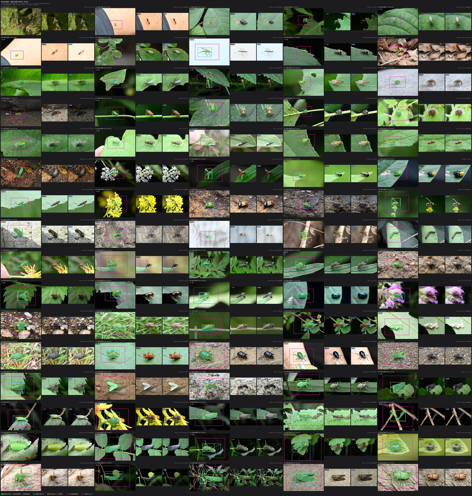
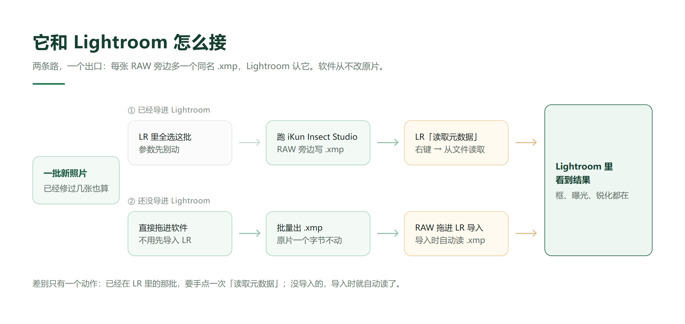

# iKun Insect Studio · 使用说明

> 给已经在拍虫子、并且用 Lightroom（或同类软件）修图的人。
> 它替你做三件重复劳动：**找虫 → 定框 → 给曝光**，结果写成 `.xmp`，Lightroom 直接认。
>
> English: [manual.en.md](manual.en.md)

---

## 0 一句话

**它不是一个修图软件，是一个「把重复动作变成参数」的批处理工具。**

跑完一批，每张 RAW 旁边会多一个同名 `.xmp`；Lightroom 读这个文件，裁切框、曝光、锐化就已经在滑杆上了。
**白平衡不动**，因为它取决于你想表达什么，不该由程序决定。

---

## 1 装好之后

1. 把压缩包解压到**一个固定目录**（不要放桌面，也别中途改名），例如 `D:/iKunInsectStudio`
2. 双击 `iKunInsectStudio.exe`
3. 首次启动加载模型约 10–20 秒，**窗口先出来、模型在后台加载**，可以直接拖照片排队
4. 想恢复出厂：关掉软件，双击同目录的 `重置到初始状态.bat`

> 需要 NVIDIA 显卡（4 GB 显存起）。没有显卡也能跑，但每张会慢到 5–10 秒。

---

## 2 五分钟跑通第一批

1. 把**一个文件夹**拖进窗口（一批最少几十张才有意义）
2. 右侧模式选 `裁切 + 曝光`
3. 「已有 XMP 的图片」选 **保护你修的图**
4. 点 **开始**
5. 跑完去 Lightroom：全选这批 → 右键 → **从文件读取元数据**

每行三张：原图 / 框与头点 / 成片。80 张扫一遍，哪张没框对直接能看出来。

---

## 3 它改了什么，不改什么

| | 内容 |
|---|---|
| **改** | 裁切框（位置 + 边长）、曝光 EV、锐化量 |
| **不改** | 白平衡、色彩、对比、局部调整 |
| **从不碰** | 原片。只写同名 `.xmp` |

三个数字从哪来：

- **裁切**：BiRefNet 掩膜 → 身体框 + 整体框 + 头点，13 个数展开成 105 项，预测框心与框宽
- **曝光**：掩膜内亮度 p95 + 框内背景亮度 p95，两个数线性回归到你标定的 EV
- **锐化**：只看光圈，越小补得越多

---

## 4 它和 Lightroom 怎么配合

两种情况，只有一个动作不同：

| 你的情况 | 要做什么 |
|---|---|
| 照片**已经在** LR 里 | 跑完软件，在 LR 里全选 → 右键 → **从文件读取元数据** |
| 照片**还没导入** LR | 先跑软件，再把 RAW 拖进 LR 导入，**导入时自动读 `.xmp`** |

**软件从不修改 RAW**，所以先跑软件还是先导入 LR 都可以，两种顺序都不会坏片。

---

## 5 标准工作流

| 步 | 在哪做 | 做什么 | 产出 |
|---|---|---|---|
| ① 选片 | 资源管理器 / LR | 按批次过一遍，糊的、抖的、重复的、遮挡的直接删 | 干净的候选集 |
| ② 挑出要精修的 | Lightroom | 只挑 5–10%，完整后期手工做完 | 几张能发表的成片 |
| ③ 跑批 · **软件** | iKun Insect Studio | 其余全部拖进去，策略选「保护你修的图」 | 每张一个 `.xmp` |
| ④ 统一微调 · **Lightroom** | Lightroom | 白平衡、整体曝光、色彩、局部调整，成批做 | 一致的色调 |
| ⑤ 导出 · **Lightroom** | Lightroom | 套预设 → 导出（尺寸、输出锐化、水印） | 交付文件 |

**②和③不能换序**：先手工修完，再让跑批跳过它们，否则刚调好的那几张会被覆盖。

### 关于第 ④ 步

**真正的微调在 Lightroom 里**——白平衡、整体曝光、色调曲线、局部蒙版，这些是成批做的，
也是决定「这一批看起来是不是一套」的地方。软件只负责把框和曝光送到滑杆上，剩下的判断归你。

> 软件**不写白平衡**是刻意的：同一个场景你想要冷一点还是暖一点，取决于表达，不取决于测量。

---

## 6 两个可选项（不属于主线）

下面两件事**都可以不做**，不做也完全能正常出片。

### 6.1 软件内微调头部位置

适用：某张图头点跑偏了，连带裁切也偏。

做法：点开那张 → 拖头点 → 点「完成」。这一笔会被记下来，
**下次遇到几何量相近的照片自动补偿**（3 条起近邻修正，25 条起切换成线性残差）。

- 只影响**裁切框的位置**，不写进 Lightroom 的任何参数
- 属于「偶尔救一张」，不是每批必做
- 记满之后可以导出成训练样本（见 6.2）

### 6.2 用自己的照片训练裁切模型

适用：你拍的题材和内置那套差别很大（全是超微距、全是群像之类）。

做法：训练页 → 添加目录 → 开始训练。训练用的是**你自己带 XMP 的成片**，
软件从里面读出你当初怎么裁的，重新拟合一套系数；训练产物和内置那套并存，随时切回。

- 需要**至少几十张**修过的照片，越多越稳
- 产物只是系数文件，不含图片，可以单独拷走
- 同样**不影响** Lightroom 里的任何东西

> 这两项都写在软件里，但它们**不是流程的一环**。正常用的话，第 ③ 步跑完就可以直接进 Lightroom 了。

---

## 7 界面说明

（待补：处理页 / 训练页 / 说明页三张截图）

---

## 8 常见问题

**Q：跑完 LR 里没变化？**
A：照片是导入之后才跑的，必须在 LR 里点一次「从文件读取元数据」；导入时跑的不用点。

**Q：会不会覆盖我修过的照片？**
A：「已有 XMP 的图片」选 **保护你修的图**，它只补你还没动过的；选「覆盖」才会全改。

**Q：为什么白平衡永远是原样？**
A：软件不猜色温。你对白平衡的设定是对固定白点的习惯，不是光源的函数，猜也猜不准。

**Q：一批跑多久？**
A：显卡正常时每张 1–3 秒；关掉实时预览更快。

---

## 9 已知限制

1. **青海那类特写**（虫占满画面、贴边、多主体）裁切偏差明显，IoU 只有 0.70，其余目录 0.76–0.88
2. **旋转裁切**约 8%，软件只出轴对齐框，这部分天生对不上
3. **不写白平衡、不做局部调整**，这两块永远交给你
4. 虫宽不到画面 8% 时掩膜会糊、框会飘——看图确认，别盲信
