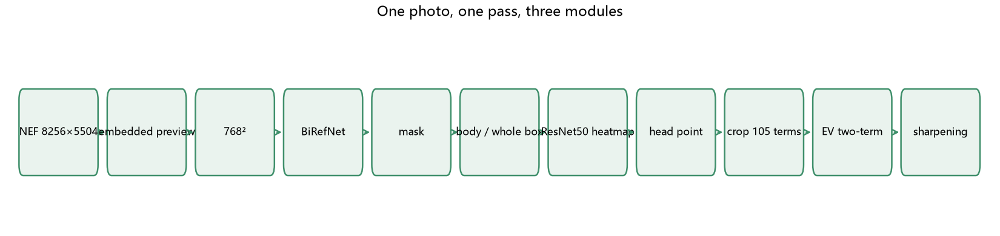
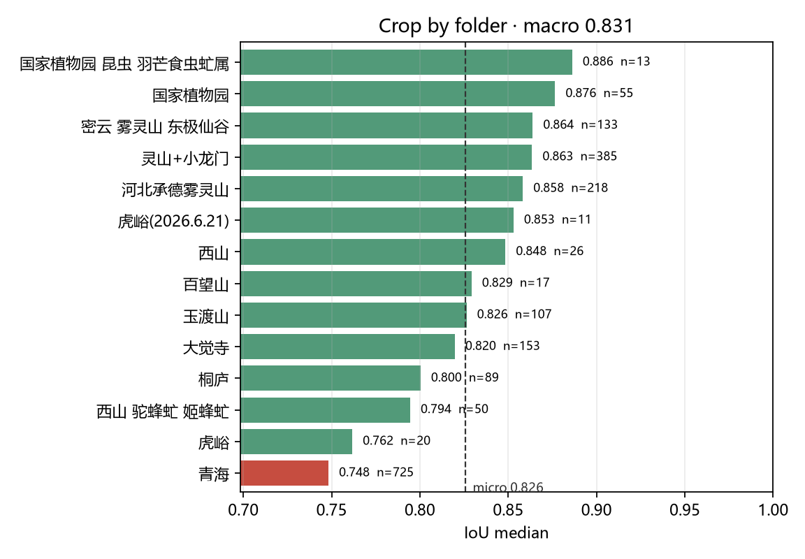
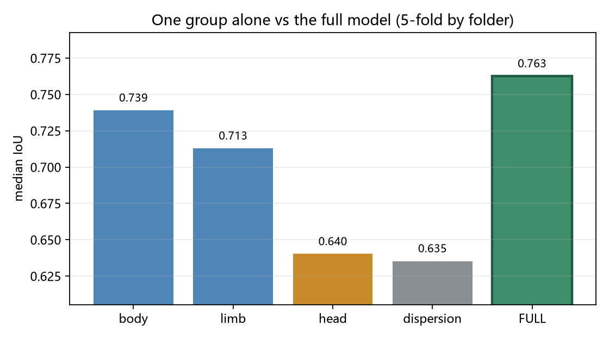
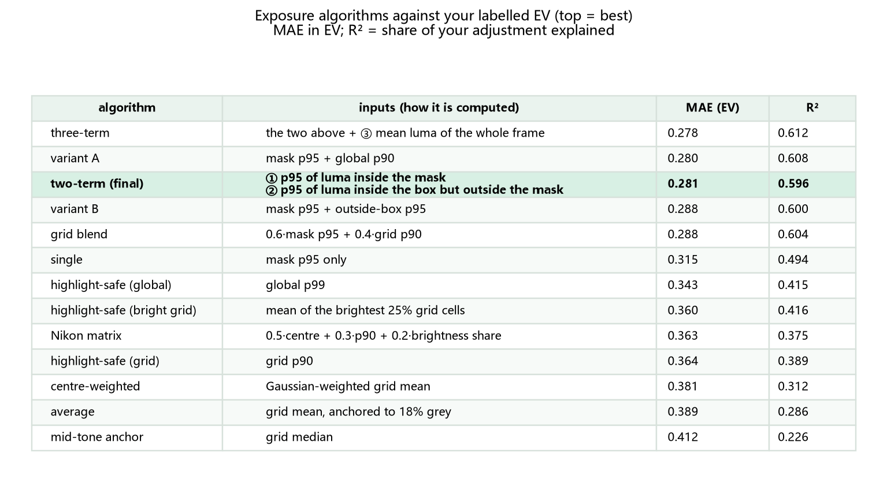
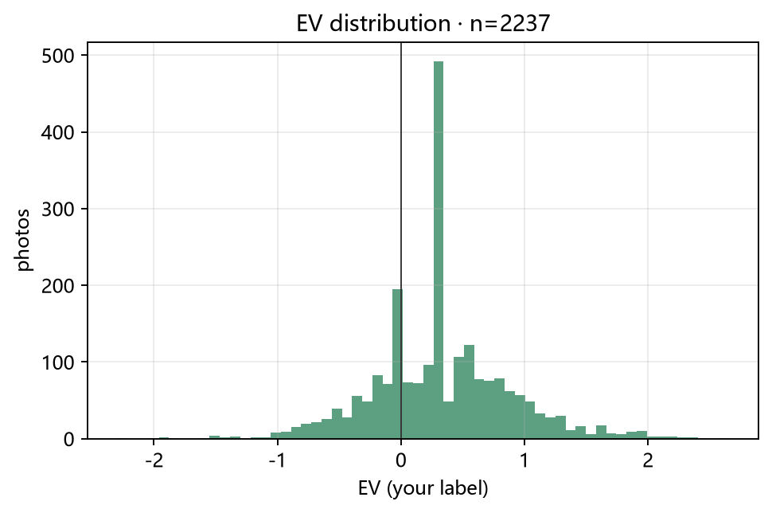
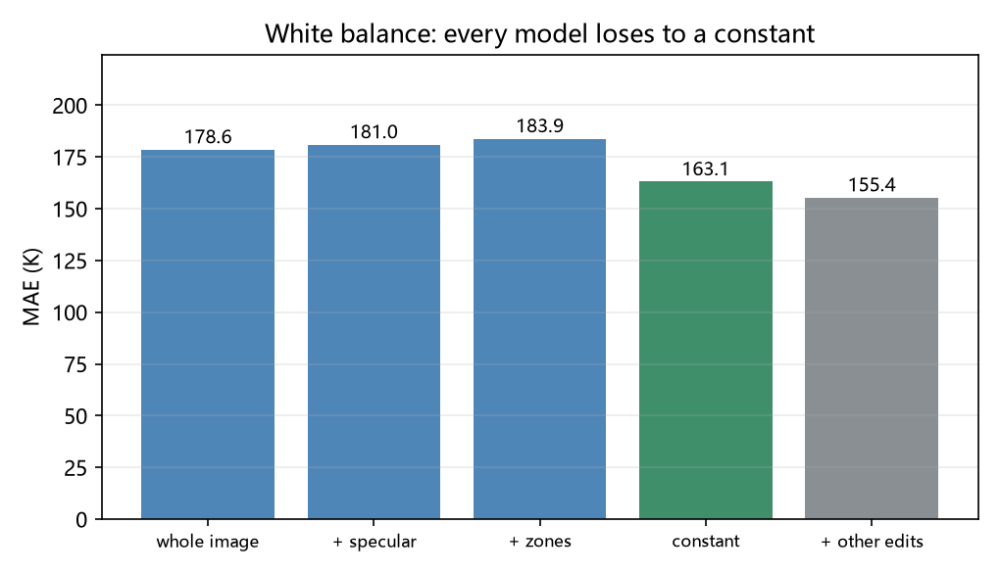

# iKun Insect Studio · Technical Report

> One sentence: turn an insect macro RAW into a **usable Lightroom crop box + exposure +
> sharpening**, by measuring three quantities on the calibation set you edited yourself.
>
> 中文版：[report.md](report.md) · Home: [../README.md](../README.md)

---

## 0 At a glance


<p align="center"><sub>Fig. 1 — one inference, end to end</sub></p>

| Module | Input | Output | Score |
|---|---|---|---|
| Crop | mask → body box / whole box / head point (13 numbers) | square box (cx, cy, width) | IoU median **0.826** |
| Exposure | p95 luma inside mask, p95 luma of box background | one EV | MAE **0.28 EV** vs your labels |
| Sharpening | aperture | one amount | by table |
| White balance | — | constant 5333 / +16 | MAE 163 K (**ceiling**) |



Nothing here is guessed: every coefficient is regressed from your own edits.
It reproduces **your habit**, not some "correct exposure" — which is exactly why white
balance can only be a constant.

---

## 1 Best result, and how it was derived

### 1.1 Crop: 0.826 holds folder by folder


<p align="center"><sub>Fig. 2 — crop IoU per folder</sub></p>



- Overall median **0.826**; macro average over 14 folders **0.831**.
- Best: the two National Botanical Garden batches (~0.88). Worst: **Qinghai, 845 photos, 0.70**.
- Qinghai is not a bug: more close-ups, edge-hugging and multi-subject frames. 85% carry an
  XMP, so they were really edited — the composition is simply outside the "regular" range.

### 1.2 What each input is worth


<p align="center"><sub>Fig. 3 — ablation: one feature group vs all</sub></p>



| group alone | median IoU |
|---|---:|
| body box | 0.739 |
| limb box | 0.713 |
| head point | 0.640 |
| dispersion | 0.635 |
| **full model (105 terms)** | **0.763** |

Body and limb are largely redundant; **the head point is the only orthogonal increment**
(weakest alone, but the only source of "which way the insect faces"); dispersion is
collinear with the two sizes and can be dropped.

> The 0.763 is a **refit** on the the calibation set and is below the shipped 0.826.
> The refit pipeline still has an unresolved issue — read this chart as **relative only**.

---

## 2 Crop: the schemes that died


<p align="center"><sub>Fig. 4 — the three lines over time</sub></p>

| # | Scheme | Result | Why it died |
|---|---|---|---|
| 1 | use the mask bbox as the crop | too tight | legs get cut; the mask excludes leg tips |
| 2 | fixed expansion factor | unstable | the needed factor varies >2× across poses |
| 3 | dispersion alone | 0.62–0.65 | one variable cannot explain size |
| 4 | add the head point | 0.640 alone | **not a failure**: only orthogonal increment |
| 5 | add log2 D | removal gains +0.0015 | collinear with the sizes, zero contribution |
| 6 | vision model regressing the box | rejected | an order of magnitude slower; answers "where", not "how big" |
| 7 | rotated box | **not done** | 8% of your crops are rotated; axis-aligned caps their IoU |
| 8 | 105-term quadratic + 3 hard rules | **0.826** | current |

Hard-constraint order cannot be swapped: ① never out of frame > ② ≥3% leg padding > ③ IoU.

---

## 3 Exposure: why two terms, not a smarter algorithm

### 3.1 The two parameters

Both come from 8-bit embedded-preview **luma** (0–100, not 0–255):

| symbol | definition | median |
|---|---|---|
| **L_in** | 95th percentile of luma **inside** the BiRefNet mask | 80 |
| **L_box** | 95th percentile inside the mask bbox **but outside** the mask | 82 |

```
EV = b0 + b1 · L_in + b2 · L_box
```

**Three-term** adds whole-frame mean luma — it moves MAE from 0.281 to 0.278, not worth an input.

### 3.2 Thirteen algorithms in one table


<p align="center"><sub>Fig. 5 — thirteen exposure algorithms</sub></p>



Every row states **its exact inputs**, including the two terms and the third one.
Findings: the best classic metering (global p99) is **0.343**, 0.062 worse than two-term;
average/centre-weighted/Nikon matrix are all worse. The reason is structural:
**the insect occupies 2.7% of the frame, so a global meter measures the background.**

### 3.3 Fit: closer to the diagonal, extremes compressed


<p align="center"><sub>Fig. 6 — the two-term fit</sub></p>


- Single 0.311 / R² 0.44; two-term **0.279 / 0.573**.
- The binned median flattens at both ends: at true −1.5 the model predicts −0.2, at +1.5 only +1.1.
  A linear model pulls extremes toward the mean. Non-linear forms were all tested and all worse.

### 3.4 The shape of the data


<p align="center"><sub>Fig. 7 — target EV distribution</sub></p>


<p align="center"><sub>Fig. 8 — absolute error per batch</sub></p>




2,241 rows → **2,237** after cleaning; your EV median is **+0.33** (you brighten on average);
per-batch MAE spans 0.15–0.45 — **batch difference, not model form, dominates the error**.

---

## 4 White balance: constant, and why


<p align="center"><sub>Fig. 9 — white balance: a constant wins</sub></p>



- Constant `T=5333 / Tint=+16`: MAE **163 K**;
- inside / outside / whole-frame partitions: −0.235 / −0.311 / −0.288 (inside is worst);
- specular highlights: r = −0.375 against ΔT but **only −0.040 against your setting**;
- 57 features + ridge/GBDT: 178.6 / 181.0 / 183.9 — **all worse than the constant 163.1**.

Root cause: the regression slope of ΔT on As Shot is **−1.000** — you fully cancel the
camera's judgement and return to a fixed white point. White balance is therefore not a
function of the illuminant; no illuminant-estimation algorithm can predict it.

> This is not "not done yet"; it is "not measurable from the current input"
> (embedded JPEG, already through camera AWB). It needs RAW linear data.

---

## 5 The current scheme, dismantled

```
NEF 8256×5504
 └ embedded preview (extract_thumb, no postprocess)
    └ 768×768 → BiRefNet (fp32)
       └ mask 768² (normalised to the full frame)
          ├ opening (r_scale 0.035) → largest component → body box
          ├ mask bbox → whole box
          └ body box +15% → 256² → ResNet50 → 64² heatmap → soft-argmax → head point
```

13 numbers → `[1] + 13 + all pairwise products = 105` → ridge λ=0.03 → cx, cy, log2(width).

| symptom | cause | handling |
|---|---|---|
| box hugs the edge, legs cut | mask misses leg tips | hard rule ② |
| only one of two insects boxed | multi-subject | head forced off, box still produced |
| head point on the abdomen | dorsal view / occlusion | no point below conf 0.02 |
| box too large | close-ups (Qinghai) | known weakness, 0.70 |
| 8% rotated crops mismatch | axis-aligned only | known, not implemented |

---

## 6 Reproduce


<p align="center"><sub>Fig. 10 — 80-photo blind test</sub></p>

```bash
python -m venv .venv && .venv/Scripts/activate
pip install -r requirements.txt
python reports/final_figs.py        # 03, 04
python reports/figs_v2.py           # 20, 21, 22
python reports/figs_table_eda.py    # 21b, 23-25
```

Every figure is recomputed from CSV by these scripts; no hand-typed numbers.
