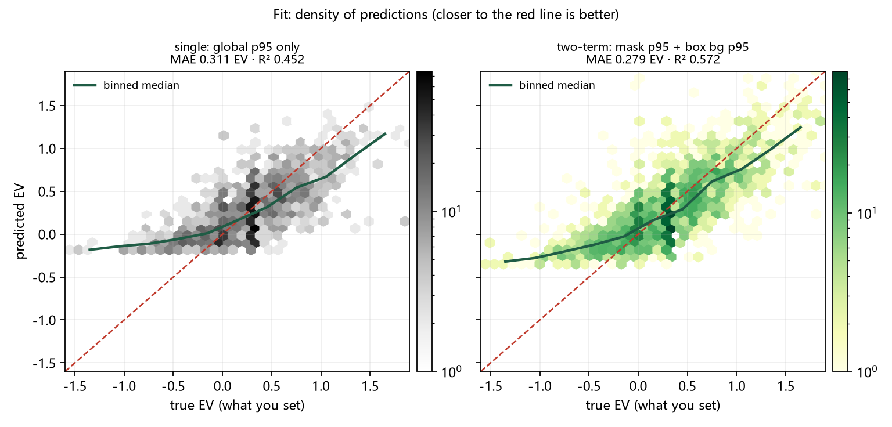
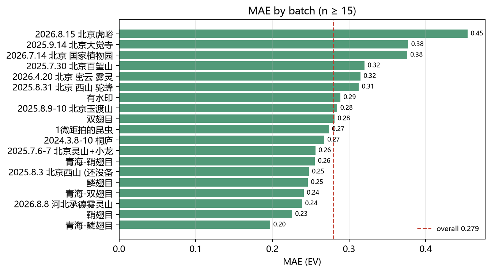

# iKun Insect Studio · Technical Report

> One sentence: turn an insect macro RAW into a **usable Lightroom crop box + exposure +
> sharpening**, by measuring three quantities on the calibation set you edited yourself.
>
> 中文版：[report.md](report.md) · Home: [../README.md](../README.md)

---

## 0 At a glance


<p align="center"><sub>Fig. 1 — one inference, end to end</sub></p>

| Module | Input | Output | Score |
|---|---|---|---|
| Crop | mask → body box / whole box / head point (13 numbers) | square box (cx, cy, width) | IoU median **0.826** |
| Exposure | p95 luma inside mask, p95 luma of box background | one EV | MAE **0.28 EV** vs your labels |
| Sharpening | aperture | one amount | by table |
| White balance | — | constant 5333 / +16 | MAE 163 K (**ceiling**) |


Nothing here is guessed: every coefficient is regressed from your own edits.
It reproduces **your habit**, not some "correct exposure" — which is exactly why white
balance can only be a constant.

---

## 1 Best result, and how it was derived

### 1.1 Crop: 0.826 holds folder by folder


<p align="center"><sub>Fig. 2 — crop IoU per folder</sub></p>


- Overall median **0.826**; macro average over 14 folders **0.831**.
- Best: the two National Botanical Garden batches (~0.88). Worst: **Qinghai, 845 photos, 0.70**.
- Qinghai is not a bug: more close-ups, edge-hugging and multi-subject frames. 85% carry an
  XMP, so they were really edited — the composition is simply outside the "regular" range.

### 1.2 What each input is worth


<p align="center"><sub>Fig. 3 — ablation: one feature group vs all</sub></p>


| group alone | median IoU |
|---|---:|
| body box | 0.739 |
| limb box | 0.713 |
| head point | 0.640 |
| dispersion | 0.635 |
| **full model (105 terms)** | **0.763** |

Body and limb are largely redundant; **the head point is the only orthogonal increment**
(weakest alone, but the only source of "which way the insect faces"); dispersion is
collinear with the two sizes and can be dropped.

> The 0.763 is a **refit** on the the calibation set and is below the shipped 0.826.
> The refit pipeline still has an unresolved issue — read this chart as **relative only**.

---

## 2 Crop: the schemes that died


<p align="center"><sub>Fig. 4 — the three lines over time</sub></p>

| # | Scheme | Result | Why it died |
|---|---|---|---|
| 1 | use the mask bbox as the crop | too tight | legs get cut; the mask excludes leg tips |
| 2 | fixed expansion factor | unstable | the needed factor varies >2× across poses |
| 3 | dispersion alone | 0.62–0.65 | one variable cannot explain size |
| 4 | add the head point | 0.640 alone | **not a failure**: only orthogonal increment |
| 5 | add log2 D | removal gains +0.0015 | collinear with the sizes, zero contribution |
| 6 | vision model regressing the box | rejected | an order of magnitude slower; answers "where", not "how big" |
| 7 | rotated box | **not done** | 8% of your crops are rotated; axis-aligned caps their IoU |
| 8 | 105-term quadratic + 3 hard rules | **0.826** | current |

Hard-constraint order cannot be swapped: ① never out of frame > ② ≥3% leg padding > ③ IoU.

---

## 3 Exposure: why two terms, not a smarter algorithm

### 3.1 The two parameters

Both come from 8-bit embedded-preview **luma** (0–100, not 0–255):

| symbol | definition | median |
|---|---|---|
| **L_in** | 95th percentile of luma **inside** the BiRefNet mask | 80 |
| **L_box** | 95th percentile inside the mask bbox **but outside** the mask | 82 |

```
EV = b0 + b1 · L_in + b2 · L_box
```

**Three-term** adds whole-frame mean luma — it moves MAE from 0.281 to 0.278, not worth an input.

### 3.2 Thirteen algorithms in one table


<p align="center"><sub>Fig. 5 — thirteen exposure algorithms</sub></p>


Every row states **its exact inputs**, including the two terms and the third one.
Findings: the best classic metering (global p99) is **0.343**, 0.062 worse than two-term;
average/centre-weighted/Nikon matrix are all worse. The reason is structural:
**the insect occupies 2.7% of the frame, so a global meter measures the background.**

### 3.3 Fit: closer to the diagonal, extremes compressed


<p align="center"><sub>Fig. 6 — the two-term fit</sub></p>



- Single 0.311 / R² 0.44; two-term **0.279 / 0.573**.
- The binned median flattens at both ends: at true −1.5 the model predicts −0.2, at +1.5 only +1.1.
  A linear model pulls extremes toward the mean. Non-linear forms were all tested and all worse.

### 3.4 The shape of the data


<p align="center"><sub>Fig. 7 — target EV distribution</sub></p>


<p align="center"><sub>Fig. 8 — absolute error per batch</sub></p>




2,241 rows → **2,237** after cleaning; your EV median is **+0.33** (you brighten on average);
per-batch MAE spans 0.15–0.45 — **batch difference, not model form, dominates the error**.

---

## 4 White balance: constant, and why


<p align="center"><sub>Fig. 9 — white balance: a constant wins</sub></p>


- Constant `T=5333 / Tint=+16`: MAE **163 K**;
- inside / outside / whole-frame partitions: −0.235 / −0.311 / −0.288 (inside is worst);
- specular highlights: r = −0.375 against ΔT but **only −0.040 against your setting**;
- 57 features + ridge/GBDT: 178.6 / 181.0 / 183.9 — **all worse than the constant 163.1**.

Root cause: the regression slope of ΔT on As Shot is **−1.000** — you fully cancel the
camera's judgement and return to a fixed white point. White balance is therefore not a
function of the illuminant; no illuminant-estimation algorithm can predict it.

> This is not "not done yet"; it is "not measurable from the current input"
> (embedded JPEG, already through camera AWB). It needs RAW linear data.

---

## 5 The current scheme, dismantled

```
NEF 8256×5504
 └ embedded preview (extract_thumb, no postprocess)
    └ 768×768 → BiRefNet (fp32)
       └ mask 768² (normalised to the full frame)
          ├ opening (r_scale 0.035) → largest component → body box
          ├ mask bbox → whole box
          └ body box +15% → 256² → ResNet50 → 64² heatmap → soft-argmax → head point
```

13 numbers → `[1] + 13 + all pairwise products = 105` → ridge λ=0.03 → cx, cy, log2(width).

| symptom | cause | handling |
|---|---|---|
| box hugs the edge, legs cut | mask misses leg tips | hard rule ② |
| only one of two insects boxed | multi-subject | head forced off, box still produced |
| head point on the abdomen | dorsal view / occlusion | no point below conf 0.02 |
| box too large | close-ups (Qinghai) | known weakness, 0.70 |
| 8% rotated crops mismatch | axis-aligned only | known, not implemented |

---

## 6 Reproduce


<p align="center"><sub>Fig. 10 — 80-photo blind test</sub></p>

```bash
python -m venv .venv && .venv/Scripts/activate
pip install -r requirements.txt
python reports/final_figs.py        # 03, 04
python reports/figs_v2.py           # 20, 21, 22
python reports/figs_table_eda.py    # 21b, 23-25
```

Every figure is recomputed from CSV by these scripts; no hand-typed numbers.

## 7 Training (optional): refit the crop model on your own exports

The built-in 105 terms were fitted on one fixed set of photos. When your subject matter differs a lot,
you can refit on **your own finished JPEGs**; the result sits alongside the built-in model and can be
switched at any time.

An export *is* the frame after cropping, so one mask pass over it yields three scale-free facts: how much
of the frame the insect takes (`1/body width`, `1/body height`), how far its centre sits from the frame
centre (`ox`, `oy`), and shape descriptors (dispersion, aspect ratio, limb share, head direction). The
model learns «shape → how many times larger, offset by how much», and inference inverts it:

    W = body width · 2^t0        centre = body centre − (ox·W, oy·H)

So **no originals and no XMP are needed** — an original is just another way to measure, not a premise.
Features must be expressed in units of frame width (divide y by that frame's own aspect), otherwise the
same insect reads as two different body types in a 3:2 and a 1:1 export.

Closed-form check: generate 240 exports from a known rule (width = body width × (4 + 0.6·limb ratio),
aspect 1.25, offset (+2%, +3%)), train on exports only, invert on 60 unseen frames — **median IoU
0.9997**. On 60 real exports the in-sample MAE was t0 0.011 / t1 0.011 / ox 0.012 / oy 0.007.

The other path is originals plus same-name XMP: the crop box comes straight from the sidecar, so labels
live in the original's coordinates. Both need at least 50 photos; the output is one coefficient file,
switchable in the app.

## 8 Implementation details (enough to rebuild it)

The first seven sections argue *why*; this one states *what is actually computed*, so another machine can
reproduce it. **No dataset provenance, no sample list, no weights.**

### 8.0 Mask, body box and subject count (what happens before the thirteen features)

**① Whole frame into the network**: the RAW's embedded full-frame JPEG (or any bitmap) is resized straight
to `size×size` (768 / 512 / 384) — **no crop, no aspect correction**; coordinates are normalised anyway,
so a squashed input costs nothing. BiRefNet runs **one fp32 forward pass** and returns a probability map.

**② Binarise and clean**: `m >= 128` (probability 0.5) gives the binary mask; keep the largest component;
merge back fragments whose centre lies within `2r+1` of the main blob (antennae, severed leg roots).

**③ Body vs limbs**: `r = round(0.035 · √area)`, then a **morphological opening** with an elliptical kernel
of radius `r`:

```
core = open(m, ellipse(2r+1))        # semantics: "regions at least 2r thick" = the body
```

The radius scales with √area, so it holds from springtails to dragonflies; a fixed pixel radius always
fails at one end. If the opening is empty, fall back to `r/2`, then to `1`. The `core` bounding box is the
body box; `full` is the bounding box of the whole mask.

> Why not morphological reconstruction: it pulls every leg attached to the body into `core` — exactly the
> wrong direction.

**④ Multiple subjects**: count components (besides the largest) with area > **8%** of the main blob.
When more than one subject is present (mating pairs, two side by side), `head` is forced to `None`, the
four head terms in §8.1 become zero, and a box is still produced.

**⑤ Normalise**: every box and point is divided by frame width/height, giving `core`, `full`, `head` in
0–1 — the inputs of the table in §8.1.

### 8.1 The thirteen inputs

The mask yields two boxes (`core` = body, `full` = with limbs); the head model yields one point. All are
normalised to the full frame (0–1).

| # | Symbol | Definition |
|---|---|---|
| 1 | `log2 D` | `D = full box area / core box area`, floored at 1.0; longer legs → larger D |
| 2 | `cw` | core box width |
| 3 | `ch` | core box height |
| 4 | `fr−fl` | full box width |
| 5 | `fb−ft` | full box height |
| 6 | `ccx−0.5` | body centre, horizontal offset from frame centre |
| 7 | `ccy−0.5` | the same, vertical |
| 8 | `(fcx−ccx)/cw` | full box offset from body box, in body widths |
| 9 | `(fcy−ccy)/ch` | the same, vertically |
| 10 | `hx` | `(head_x−ccx)/cw` |
| 11 | `hy` | `(head_y−ccy)/ch` |
| 12 | `hx·(ccx−0.5)` | head × body offset, horizontal interaction |
| 13 | `hy·(ccy−0.5)` | the same, vertical |

With a second subject (another blob >8% of the main one) or no head point, terms 10–13 are set to zero —
a "headless" variant that still produces a box.

### 8.2 From thirteen numbers to 105 terms

`[1] + 13 terms + every pairwise product (squares included)` = 1 + 13 + 13·14/2 = **105**. Ridge with
λ = 0.03 on standardised features; **the intercept column is not penalised** (`mu=0, sd=1`). Three targets:

    cx, cy ∈ (0,1)        log2(box width) ∈ ℝ

Hold-out is **5-fold by batch** — one shoot or one folder never spans folds. Random splits let near-duplicate
frames leak into validation and inflate the score.

### 8.3 Constraint order (do not reorder)

```
1. contain the full box: w = max(w, full width + 2·pad, full height + 2·pad), pad = 0.03
2. cannot fit the canvas (w > 1): w = 1, flag canvas_limited
3. clamp the centre into the no-leg-cut region, then into [0,1]
```

Step 1 is hard: a larger box beats a clipped leg. Step 2 only fires when the subject fills the frame.
Step 3 translates only, never resizes — resizing would undo step 2.

### 8.4 Exposure and sharpening

    EV = 3.0416 − 0.02108·L_in − 0.01362·L_box

`L_in` is the p95 luminance inside the mask, `L_box` the p95 between box and mask, both sRGB 0–255.
Sharpening is a lookup by aperture, strictly increasing 20 → 65, no interpolation or extrapolation.
White balance is the constant 5333 / +16 (see section 4).

### 8.5 The head network, layer by layer

**Where the input comes from**: the body box `core` is expanded by **15%** on each side (`pad=0.15`,
relative to core's own width/height, clipped at the frame), cropped from the **preview-resolution**
image, resized bilinearly to **256×256**, divided by 255, then normalised with ImageNet mean
`(0.485, 0.456, 0.406)` / std `(0.229, 0.224, 0.225)`.

**Backbone and fusion** (ResNet50, ImageNet `IMAGENET1K_V2` weights):

| Stage | Structure | Output |
|---|---|---|
| stem | conv1 7×7/2 + bn + relu + maxpool 3×3/2 + layer1(3 blocks) + layer2(4 blocks) | 512 ch @ /8 |
| layer3 | 6 blocks | 1024 ch @ /16 |
| layer4 | 3 blocks | 2048 ch @ /32 |
| p3 | 1×1 conv | 256 ch @ /16 |
| p4 | 1×1 conv 2048→256, bilinear upsample ×2 | 256 ch @ /16 |
| fuse | **p3 + p4 (sum, not concatenation)** | 256 ch @ /16 |
| upsample | bilinear to 64×64 | 256 ch @ 64² |
| head | 3×3 256→128 + BN + LeakyReLU(0.1); 3×3 128→64 + BN + LeakyReLU(0.1); 1×1 64→1 | **1 ch @ 64² (logits)** |

**From heatmap to a coordinate** (one softmax over all 4096 cells, not per-cell sigmoid):

```
p  = softmax(logits.reshape(1, 4096)).reshape(1, 64, 64)
u  = Σ p · (i + 0.5) / 64        # horizontal expectation, sub-cell precision
v  = Σ p · (i + 0.5) / 64        # vertical
x  = l + u · (r − l)             # back to full-frame normalised coords
y  = t + v · (b − t)
conf = p.max()                   # only a very low gate (default 0.05) for fully diffuse maps
```

Expectation rather than argmax because the peak is genuinely flat (measured conf 0.034–0.064, median
0.056): argmax jumps within a cell, the expectation is far steadier. Health check is `pred_std` —
0.24–0.27 normally, ≈0 when the model has collapsed.

**Training**: 256×256 chips, ImageNet initialisation, **40 epochs**, soft-target cross-entropy over a
Gaussian heatmap. Same dataset and loss: 4-layer CNN from scratch **5%**, from scratch with soft-target
CE **22%**, ImageNet init with soft-target CE **90%**. From scratch, all five folds converge to the same
loss (3.79–3.81) — it learns a position prior, not the image.

> The training script was not shipped with the weights; the checkpoint records only `epochs=40`, `size`
> and `pad`. Optimiser, learning rate and augmentation belonged to that training run and are not
> invented here.

Inference cost: 30 ms per photo (GTX 1650, fp32).

### 8.6 What the tiers cost

| Tier | Peak VRAM | Per photo | Mask agreement with 768 |
|---|---:|---:|---:|
| 768 | ≈2.3 GB | 0.77 s | — |
| 512 | ≈1.5 GB | 0.50 s | 0.962 |
| 384 | ≈0.9 GB | 0.39 s | 0.928 |

The gap lives at the edges of small insects (<10% of frame width); larger subjects are indistinguishable.
**Picking a tier above free VRAM does not error — it pages through system memory: 0.77 s → 3.19 s measured.**
