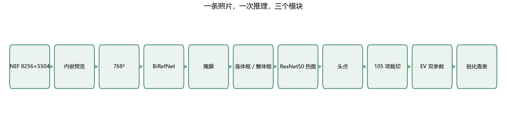
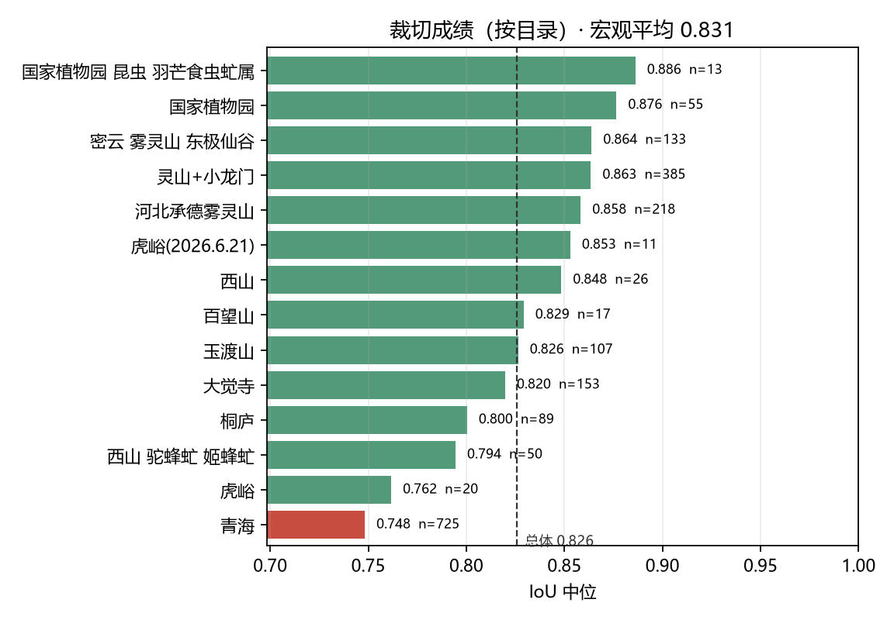
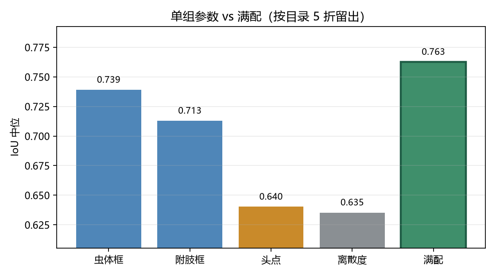
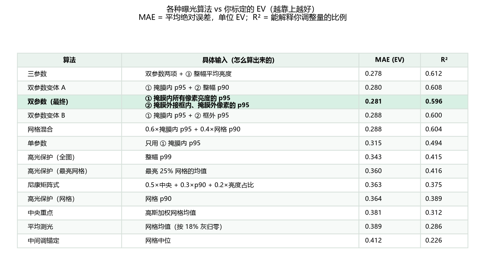
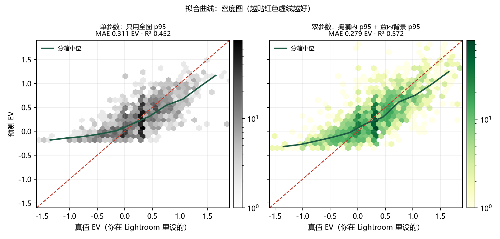
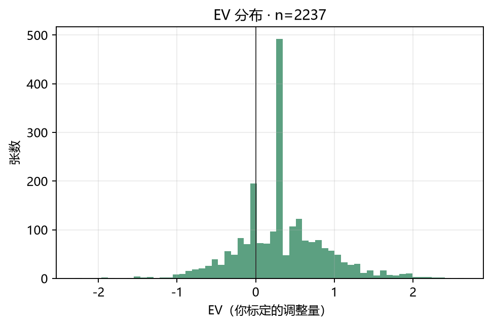
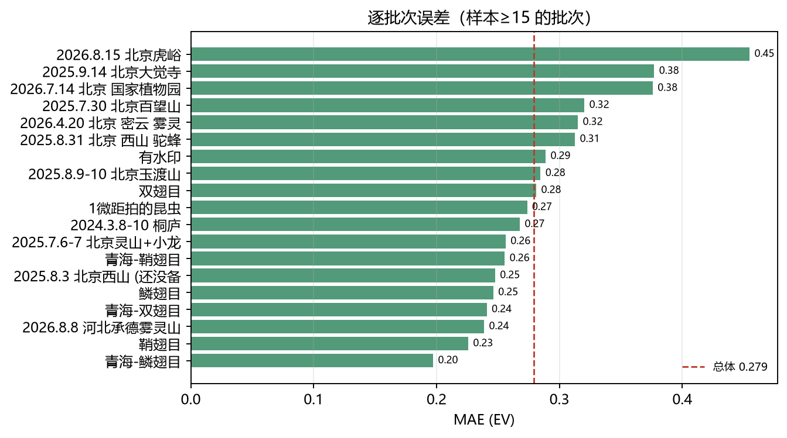
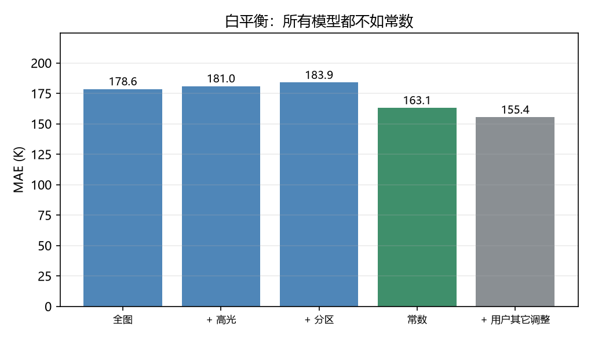

# iKun Insect Studio · 技术报告

> 一句话：把「昆虫微距原片」到一个**能直接用的 Lightroom 裁切框 + 曝光 + 锐化**这件事，
> 拆成三个可测量的量，用你亲手修过的成片标定出来。
>
> English: [report.en.md](report.en.md) · 首页 [../README.md](../README.md)

---

## 0 一页看懂


<p align="center"><sub>图 1　一次推理的完整链路：掩膜 → 三个框 + 头点 → 105 项 → 裁切框</sub></p>

| 模块 | 输入 | 输出 | 成绩 |
|---|---|---|---|
| 裁切 | 掩膜 → 身体框 / 整体框 / 头点（13 个数） | 正方形框（框心 x、框心 y、框宽） | IoU 中位 **0.826** |
| 曝光 | 掩膜内亮度 p95、盒内背景亮度 p95 | 一个 EV | MAE **0.28 EV**（你标定值） |
| 锐化 | 光圈 | 一个锐化量 | 按档位 |
| 白平衡 | — | 常数 5333 / +16 | MAE 163 K（**上限**） |



这四行的共同点：**没有一行是"估"出来的**，全部是在你亲手修过的成片上回归出来的系数。
所以它复现的是**你的习惯**，不是某种"正确曝光"——这也是白平衡只能给常数的原因。

---

## 1 最好的结果，以及它是怎么来的

### 1.1 裁切：0.826 不是均值，是逐目录都成立


<p align="center"><sub>图 2　逐目录裁切 IoU：四张特写目录拖了平均分</sub></p>



- 总体中位 **0.826**，逐目录中位再平均 **0.831**（14 个目录）。
- 最好的两个是国家植物园两批（0.88 左右），最差的是**青海 845 张：0.70**。
- 青海低不是 bug：那批里特写、贴边、多主体的比例明显更高，85% 有 XMP 说明它们确实被修过，
  只是构图不在"常规"范围内。**这是当前模型的真实边界，报告里不藏。**

### 1.2 每个输入值多少：四组单用 vs 满配


<p align="center"><sub>图 3　消融：四组特征单用 vs 满配</sub></p>



| 只用这一组 | IoU 中位 |
|---|---:|
| 虫体框（core 的宽高 + 中心） | 0.739 |
| 附肢框（full 的宽高 + 相对偏移） | 0.713 |
| 头点（hx, hy + 两个交互项） | 0.640 |
| 离散度（log2 D） | 0.635 |
| **满配（13 项 → 105 项）** | **0.763** |

读法：**虫体和附肢高度冗余**（0.739 vs 0.713），谁单独用都能撑住大半；
**头点是唯一的正交增量**——它单独最弱（0.640），但只有它能补上"虫头朝哪边"这个信息；
**离散度挖掉不掉分**，因为和两个尺寸严格共线。

> 注：这里的满配 0.763 是**在同一批图上重拟合**的结果，低于出厂系数的 0.826。
> 重拟合管线还有未查清的问题，所以这张图**只看相对差距**，绝对值以 0.826 为准。

---

## 2 裁切线：走过的方案，和它们为什么死


<p align="center"><sub>图 4　三条线（裁切 / 曝光 / 白平衡）走过的方案与时间</sub></p>

这一节按时间顺序，**失败的一样写**——论文通常不写，但这里必须写，否则读者会以为
"105 项"是拍脑袋想出来的。

| # | 方案 | 结果 | 为什么死 |
|---|---|---|---|
| 1 | 直接用掩膜外接框当裁切框 | 太紧 | 腿被切；掩膜本来就不含长腿末端 |
| 2 | 掩膜框固定比例外扩（如 1.2×） | 不稳 | 不同虫、不同姿态需要的外扩比例差 2 倍以上 |
| 3 | 只用"离散度 D"拟合 | 0.62–0.65 | 单变量解释不了尺寸，D 与两个宽高共线 |
| 4 | 加头点 | 单独 0.640 | **不是失败**：它是唯一正交增量，挖掉必掉 0.008 |
| 5 | 加 log2D | 挖掉反而 +0.0015 | 与四尺寸共线，零贡献，删 |
| 6 | 视觉模型直接回归框（DINO/SAM） | 未采用 | 慢一个数量级，且它回答"虫在哪"，不回答"框多大" |
| 7 | 旋转框 | **未做** | 你的裁切 8% 有角度；当前只出轴对齐框，这部分 IoU 天生封顶 |
| 8 | 105 项二次式 + 三条硬约束 | **0.826** | 现方案 |

**三条硬约束的顺序不能换**：① 绝不出界 > ② 腿留白 ≥3% > ③ IoU。
先保证画布装得下，再保证不切腿，最后才谈像不像。

---

## 3 曝光线：为什么是"双参数"，不是"更聪明的算法"

### 3.1 双参数到底是哪两个

都取自 8-bit 内嵌预览的**亮度**（0–100 的百分比，不是 0–255）：

| 记号 | 定义 | 中位 |
|---|---|---|
| **L_in** | BiRefNet 掩膜**里面**所有像素亮度的 **95 分位**（虫子身上的高光） | 80 |
| **L_box** | 掩膜**外接矩形内、但掩膜外**那圈像素的 95 分位（虫子周围的背景） | 82 |

```
EV = b0 + b1 · L_in + b2 · L_box
```

**三参数**就是再加一个 `整幅平均亮度`——只把 MAE 从 0.281 压到 0.278，多一个输入不值。

### 3.2 13 种算法，一张表


<p align="center"><sub>图 5　13 种曝光算法，双参数那行贴着对角线</sub></p>



**表里每一行都写了"具体输入"**，包括双参数的两项、三参数的第三项。
结论：

- 最好的传统测光（全图 p99）**0.343**，比双参数差 0.062；
- 平均测光 0.389、中央重点 0.381、尼康矩阵 0.363——**全军覆没**；
- 原因很硬：**虫子中位只占画面 2.7%，平均测光测的是背景，不是虫。**

### 3.3 拟合曲线：双参数更贴对角线，但极值被压缩


<p align="center"><sub>图 6　双参数拟合：中段贴得紧，两端被压缩</sub></p>



- 单参数 MAE 0.311 / R² 0.44，双参数 **0.279 / 0.573**。
- **中位线在两端都压平**：你真值 −1.5，模型只敢给 −0.2；+1.5 只到 +1.1。
  线性模型把极值往均值拉——这是模型性质，不是画图问题。要修只能上分段/非线性，
  而报告里已证明非线性全否（0.281 → 0.284+）。

### 3.4 数据的脾气


<p align="center"><sub>图 7　目标 EV 分布：集中在 −0.5～+0.5，极端值很少</sub></p>


<p align="center"><sub>图 8　逐批绝对误差：批次间差异是主要误差来源</sub></p>




- 你的 EV 中位 **+0.33**（整体在提亮），范围 −2.29 ~ +2.65；
- 2,241 行 → 清洗后 **2,237**（3 行 ERR、1 行越界）；
- 逐批 MAE 在 0.15–0.45 之间，**批次间差异是误差的主要来源**（不是模型形式）。

---

## 4 白平衡线：为什么只能是常数


<p align="center"><sub>图 9　白平衡：所有方案都不如一个常数</sub></p>



- 常数 `T=5333 / Tint=+16`：MAE **163 K**；
- 掩膜内 / 掩膜外 / 全图三种分区：−0.235 / −0.311 / −0.288（**掩膜内最差**）；
- 镜面高光：`band.rg` 对 ΔT 的 r = −0.375，但**对你设的值只有 r = −0.040**；
- 57 维特征 + 岭回归 / GBDT：178.6 / 181.0 / 183.9，**全部不如常数 163.1**。

**根源**：ΔT 对 As Shot 的回归斜率 **−1.000**——你把相机的判断**完全抵消**了，
回到一个固定白点。所以白平衡不是光源的函数，任何"估光源"的算法在原理上都预测不了它。

> 这不是"暂时没做"，是"以目前输入（内嵌 JPEG，已过相机 AWB）测不出来"。
> 唯一前提是拿到 RAW 线性数据（需要支持 Z8 HE 的 LibRaw）。

---

## 5 现方案，彻底拆开

### 5.1 一次推理产生的全部数字

```
NEF 8256×5504
 └ 内嵌预览（extract_thumb，不经 postprocess）
    └ 768×768 → BiRefNet（fp32）
       └ 掩膜 768²（坐标 = 整幅归一化）
          ├ 开运算(≈r_scale 0.035) → 最大连通块 → 身体框 core
          ├ 掩膜外接矩形 → 整体框 full
          └ core 外扩 15% → 256² → ResNet50 → 64² 热图 → soft-argmax → 头点
```

### 5.2 13 个数怎么变成 105 项

`[1] + 13 项 + 全部两两乘积（含平方）= 105`，岭回归 λ=0.03，三个目标：
框心 x、框心 y、log2(框宽)。**没有第 5 类输入**——这是你定的规矩。

### 5.3 失败模式手册

| 症状 | 原因 | 处理 |
|---|---|---|
| 框贴边、腿被切 | 掩膜漏了长腿 | 硬约束 ② 兜底；报告标注 |
| 两只虫只框住一只 | 多主体 | 强制关头（head=None），仍出框 |
| 头点跑到腹部 | 纯背面 / 遮挡 | 置信度 < 0.02 时不画头点 |
| 框比虫子大一圈 | 特写（青海那类） | 已知短板，0.70 |
| 8% 旋转裁切对不上 | 只出轴对齐框 | 已知，未做 |

---

## 6 复现


<p align="center"><sub>图 10　80 张盲测三联：原图 / 框与头点 / 成片</sub></p>

```bash
python -m venv .venv && .venv/Scripts/activate
pip install -r requirements.txt

python reports/final_figs.py        # 03 逐目录 / 04 分布
python reports/figs_v2.py           # 20 消融 / 21 算法柱 / 22 曲线
python reports/figs_table_eda.py    # 21b 表 / 23–25 EDA
python reports/rebuild_analysis.py  # 全量裁切 + 消融 + 曝光
```

所有图都由 `reports/*.py` 从 CSV 重算，不依赖任何手工数字。

## 7 训练（可选）：用自己的成片重拟合裁切

内置那套 105 项系数是按一批固定照片学出来的。题材差别大时，可以拿**你自己修好的成品 JPG**
重拟合一套，和内置并存、随时切回。

成片本身就是裁切后的画面，所以在成片上跑一次掩膜，能量到三件与尺度无关的事：虫体占画面的
比例（`1/虫宽`、`1/虫高`）、虫心偏离画面中心多少（`ox`、`oy`）、以及形状描述量（离散度、
体型比、附肢占比、头朝向）。模型学的是「形状 → 该放大多少倍、往哪偏」，推理时反解：

    W = 虫宽 · 2^t0        中心 = 虫心 − (ox·W, oy·H)

因此**不需要原片、不需要 XMP**——原片只是另一种量法，不是前提。特征必须换算到「以画幅宽为
单位」（y 除以该帧自身宽高比），否则同一只虫在 3:2 与 1:1 的成片里会被算成两种体型。

封闭检验：用已知规律生成 240 张成片（宽 = 虫宽 ×（4 + 0.6×附肢比）、宽高比 1.25、虫心偏
(+2%, +3%)），只用成片训练，再拿 60 张没见过的原片反解，**IoU 中位 0.9997**。真实数据上
60 张成片的样本内 MAE：t0 0.011 / t1 0.011 / ox 0.012 / oy 0.007。

另一条路是原片 + 同名 XMP：裁切框直接读 sidecar，标签落在原片坐标系。
两条路都至少需要 50 张，产物是一个系数文件，进模型库后可切换。

## 8 实现细节（照着能重写一遍）

前七节讲"为什么"，这节只讲"到底怎么算"，够另一台机器照着复现。**不含数据来源、样本清单与权重文件**。

### 8.0 掩膜、躯干框与主体计数（在 13 项特征之前发生的事）

**① 整幅进网络**：RAW 的内嵌全幅 JPEG（或位图原图）直接缩放到 `size×size`（768 / 512 / 384），
**不裁、不改比例**——坐标本来就用归一化，压缩形变不影响还原。BiRefNet **fp32 单次前向**，
输出概率图。

**② 二值化与连通域**：`m >= 128`（即概率 0.5）取二值；取最大连通域；把离主块中心距 ≤ `2r+1`
的碎块并回（触角、腿根被切断时用）。

**③ 躯干 / 附肢拆分**：`r = round(0.035 · √面积)`，用半径 `r` 的椭圆核做**形态学开运算**：

```
core = open(m, ellipse(2r+1))        # 语义 = 「局部厚度 ≥ 2r 的部分」= 本体
```

按 √面积 自适应，所以从跳虫到蜻蜓两个数量级都成立；固定像素半径必然在某一端失效。
开运算为空时退到 `r/2`，再退到 `1`。`core` 的外接框 = 躯干框；`full` = 整个掩膜的外接框。

> 为什么不用形态学重建：重建会把连在身体上的腿全部并进 `core`，方向正好相反。

**④ 多主体判定**：最大连通域之外，统计面积 > 主块 **8%** 的块数。
判定为多主体（交配对、两只并排）时**强制 `head=None`**，13 项里的头 4 项置 0，仍出框。

**⑤ 归一化**：所有框和点除以画幅宽/高，得到 0–1 的 `core`、`full`、`head`——这也是 8.1 那张表的输入。

### 8.1 十三项输入，逐项定义

掩膜给两个框（`core` 躯干、`full` 含附肢），头点给一个坐标，全部是**全幅归一化**（0–1）。

| # | 符号 | 定义 |
|---|---|---|
| 1 | `log2 D` | `D = 全身框面积 / 躯干框面积`，最小 1.0。腿越长越散，D 越大 |
| 2 | `cw` | 躯干框宽（归一化） |
| 3 | `ch` | 躯干框高 |
| 4 | `fr−fl` | 全身框宽 |
| 5 | `fb−ft` | 全身框高 |
| 6 | `ccx−0.5` | 躯干中心横向偏离画面中心 |
| 7 | `ccy−0.5` | 躯干中心纵向偏离 |
| 8 | `(fcx−ccx)/cw` | 全身框相对躯干的横向偏移，除以躯干宽 |
| 9 | `(fcy−ccy)/ch` | 同上，纵向 |
| 10 | `hx` | `(头x−ccx)/cw` |
| 11 | `hy` | `(头y−ccy)/ch` |
| 12 | `hx·(ccx−0.5)` | 头横向 × 躯干横向，交互项 |
| 13 | `hy·(ccy−0.5)` | 头纵向 × 躯干纵向，交互项 |

多主体（第二块 > 主块 8%）或头点缺失时，第 10–13 项置 0——等价于一个"无头版"模型，仍出框。

### 8.2 105 项怎么来

`[1] + 13 项 + 全部两两乘积（含平方）`：1 + 13 + 13·14/2 = **105**。岭回归，λ = 0.03，
按特征做标准化，**截距那列不惩罚**（`mu=0, sd=1`）。三个输出分别拟合：

    cx, cy ∈ (0,1)        log2(框宽) ∈ ℝ

留出评估按**批次**做 5 折（同一场次/同一目录不跨折），不是随机分——随机分会让同批照片的相似性
漏进验证集，指标虚高。

### 8.3 约束顺序（不可颠倒）

```
① 装下全身框：w = max(w, 全身框宽+2·pad, 全身框高+2·pad)，pad = 0.03
② 画布装不下（w > 1）：w = 1，标记 canvas_limited
③ 框心夹进"不切腿"可行域，再夹进 [0,1]
```

①是硬约束：宁可框大，不能切腿。②只在极端情况触发（虫子撑满画面）。
③只平移不改尺寸——改尺寸会破坏②的判断。

### 8.4 曝光与锐化

    EV = 3.0416 − 0.02108·L_in − 0.01362·L_box

`L_in` = 掩膜内 p95 亮度，`L_box` = 框内、掩膜外的 p95 亮度，都是 sRGB 0–255 口径。
锐化按光圈查表，20 → 65 严格递增，不做插值外推。白平衡固定 5333 / +16（理由见第 4 节）。

### 8.5 头点网络：逐层、逐步

**输入从哪来**：躯干框 `core` 四边各外扩 **15%**（`pad=0.15`，按 core 自身的宽高算，超出画幅就截断），
从**预览分辨率**的原图上裁出这块，双线性缩放到 **256×256**，`/255` 后按 ImageNet 的
mean `(0.485, 0.456, 0.406)` / std `(0.229, 0.224, 0.225)` 归一化。

**骨干与融合**（ResNet50，ImageNet `IMAGENET1K_V2` 权重）：

| 阶段 | 结构 | 输出 |
|---|---|---|
| stem | conv1 7×7/2 + bn + relu + maxpool 3×3/2 + layer1(3 block) + layer2(4 block) | 512 ch @ /8 |
| layer3 | 6 block | 1024 ch @ /16 |
| layer4 | 3 block | 2048 ch @ /32 |
| p3 | 1×1 卷积 | 256 ch @ /16 |
| p4 | 1×1 卷积 2048→256，双线性上采样 ×2 | 256 ch @ /16 |
| 融合 | **p3 + p4（相加，不是拼接）** | 256 ch @ /16 |
| 上采样 | 双线性到 64×64 | 256 ch @ 64² |
| head | 3×3 256→128 + BN + LeakyReLU(0.1)；3×3 128→64 + BN + LeakyReLU(0.1)；1×1 64→1 | **1 ch @ 64²（logits）** |

**怎么从热图得到坐标**（整个 4096 格做一次 softmax，不是逐格 sigmoid）：

```
p  = softmax(logits.reshape(1, 4096)).reshape(1, 64, 64)
u  = Σ p · (i + 0.5) / 64        # 横向期望，带亚格精度
v  = Σ p · (i + 0.5) / 64        # 纵向
x  = l + u · (r − l)             # 映回全幅归一化
y  = t + v · (b − t)
conf = p.max()                   # 只用于极低门槛（默认 0.05）过滤完全发散的图
```

用期望而不是 argmax，是因为峰值本来就很平（实测 conf 只有 0.034–0.064，中位 0.056）：
argmax 会在一格之内跳，期望值稳定得多。判据看 `pred_std`，正常 0.24–0.27，塌陷时≈0。

**训练口径**：256×256 的 chip、ImageNet 预训练初始化、**40 轮**、软目标交叉熵（高斯软标签的热图）。
同一数据集同损失的对照：从零训 4 层卷积 **5%**、从零训 + 软目标交叉熵 **22%**、
ImageNet 初始化 + 软目标交叉熵 **90%**。从零训时五折 loss 收敛到同一值（3.79–3.81），
说明它学的是位置先验而非图像。

> 训练脚本没有随权重发布，权重里只记录了 `epochs=40`、`size`、`pad` 三项；
> 优化器、学习率、增强策略属于当时那次训练的环境，本报告不虚构。

推理成本：30 ms/张（GTX 1650，fp32）。

### 8.6 精度分档的代价

| 档位 | 峰值显存 | 单张 | 与 768 的掩膜一致度 |
|---|---:|---:|---:|
| 768 | ≈2.3 GB | 0.77 s | — |
| 512 | ≈1.5 GB | 0.50 s | 0.962 |
| 384 | ≈0.9 GB | 0.39 s | 0.928 |

差的是小虫（占画幅 <10%）的边缘；大体型三档几乎无差。**选高于可用显存的档不会报错，会走 WDDM
分页，实测 0.77 s → 3.19 s。**
